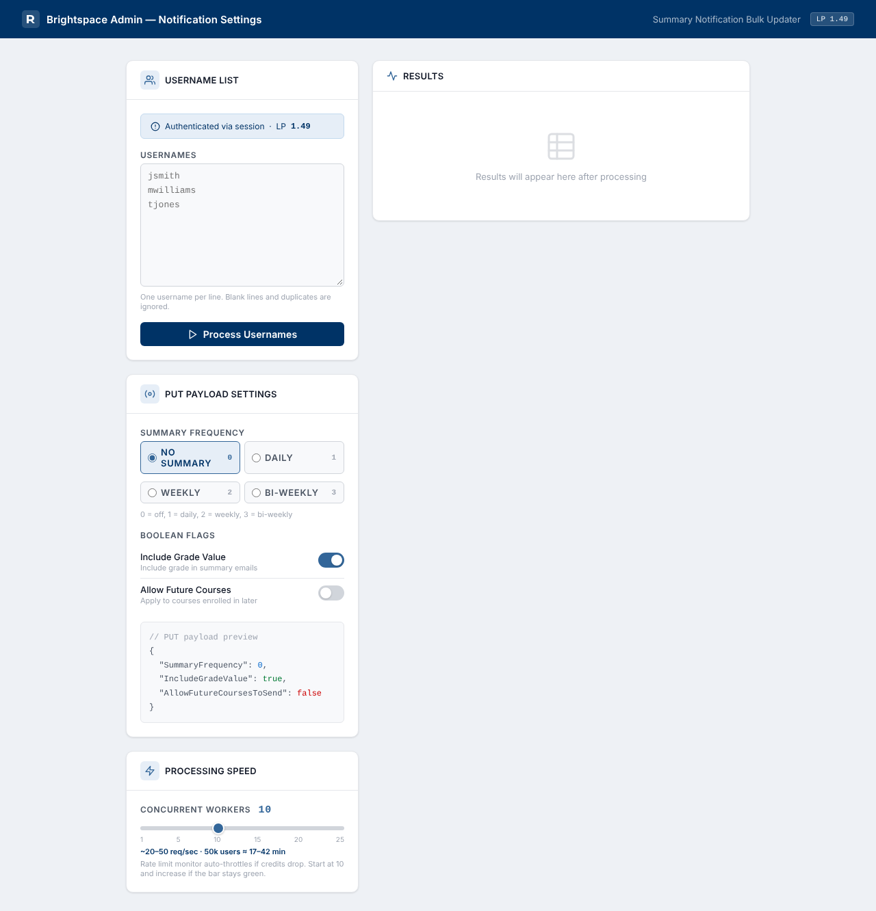
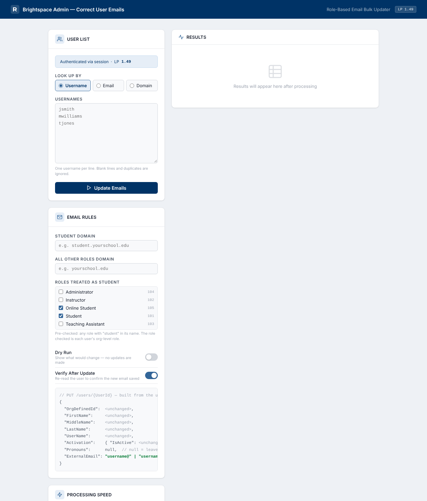
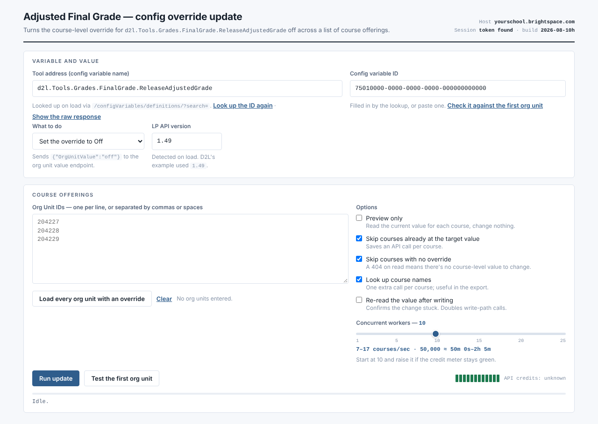
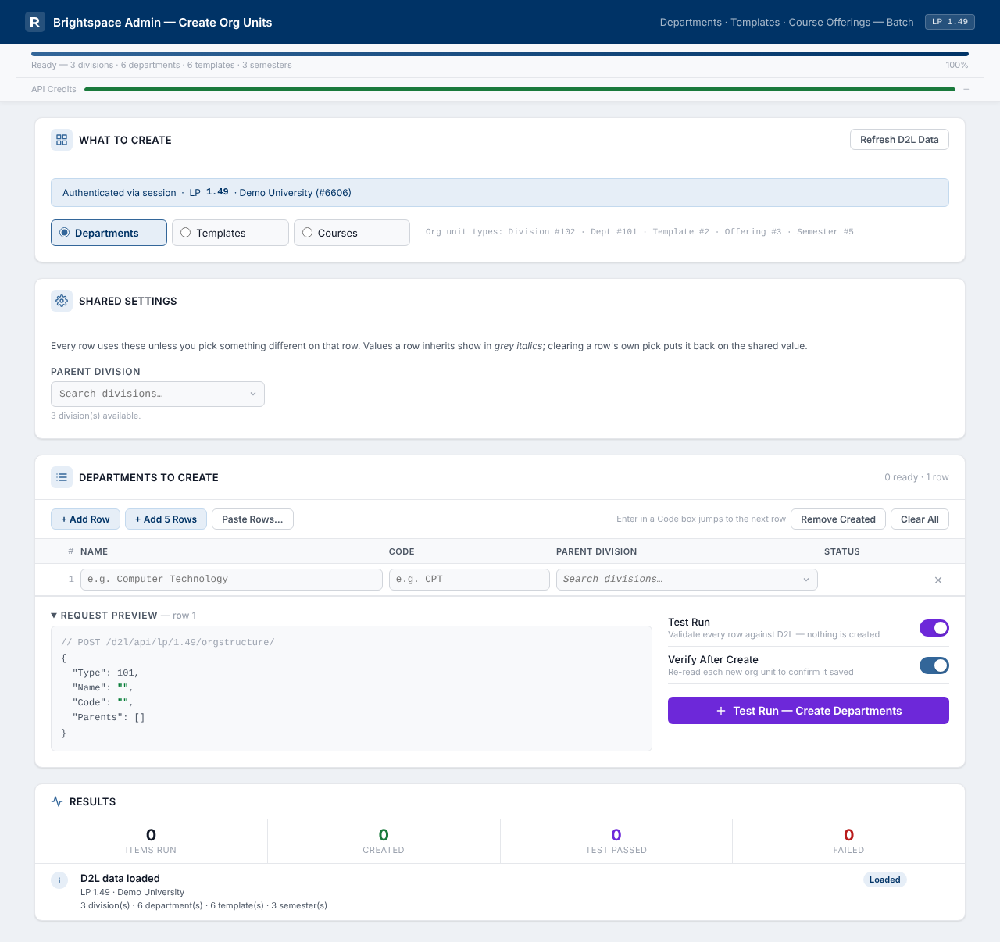
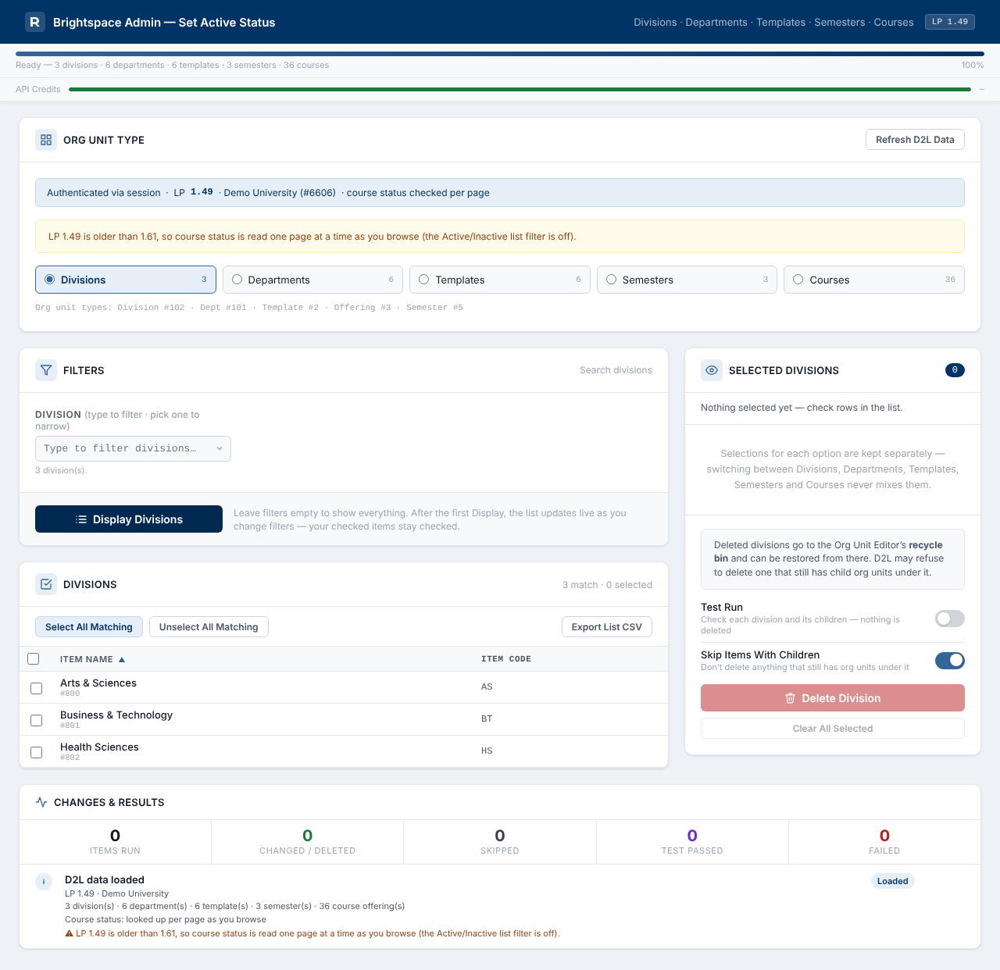
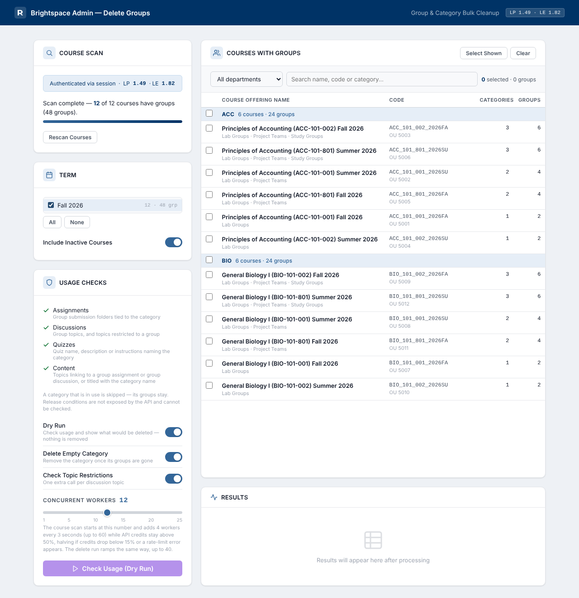

# 🔧 Admin Tools

Bulk tools for **D2L Brightspace administrators**. Each one changes hundreds or thousands of records in minutes, work that would otherwise take days of clicking through the Brightspace interface.

Every tool is a **single, self-contained HTML file**. It runs inside your Brightspace site with your existing login, so there are no API keys, servers, or installs.

> 📸 Screenshots show sample data from a demo environment, not real users or courses.

---

## 📑 Tools in This Folder

| Tool | File |
|------|------|
| [Summary Notification Settings Updater](#summary-notification-settings-updater) | `d2l_notification_updater.html` |
| [Correct User Emails](#correct-user-emails) | `d2l_correct_user_emails.html` |
| [Adjusted Grade Config Updater](#adjusted-grade-config-updater) | `adjusted-grade-config-update.html` |
| [Create Org Units](#create-org-units) | `d2l_create_org_units.html` |
| [Set Active Status](#set-active-status) | `d2l_set_active_status.html` |
| [Delete Groups](#delete-groups) | `d2l_delete_groups.html` |

---

## 🚀 Before You Start

1. **Upload the files** to a folder in **Admin Tools → Public Files**, for example `Admin_Tools`.
2. **Open a tool** from its URL while signed in to Brightspace:
   `https://YOUR-BRIGHTSPACE-URL/shared/Admin_Tools/d2l_notification_updater.html`
3. **Restrict access.** Put the links in a custom navbar link or widget that only administrators can see. See the [main README](../README.md#2-upload-it-to-d2l-brightspace) for step-by-step instructions.

**Shared features**
- 🔑 **Your login, your permissions.** Each tool can only do what your Brightspace role can already do.
- 🧪 **Test before you change.** Most tools offer a preview, test run, or dry run.
- 🚦 **Built-in rate limiting.** Tools slow down automatically when Brightspace asks, and retry safely.
- 📄 **Exportable results.** Each run shows a status for every item, and most tools export to CSV.

> ⚠️ These tools make bulk changes. Always try a small test run first, ideally in a test environment.

---

## Summary Notification Settings Updater

**File:** `d2l_notification_updater.html`

### What it does
Updates the **Summary Notification** settings for a list of users in one run. Brightspace's summary emails can only be changed one user at a time in the interface; this tool does the whole list at once.

### Use it for
- Turning summary emails off (or on) for a whole group of users
- Setting everyone to the same frequency at the start of a term
- Fixing users who are getting unwanted digest emails

### How to use it
1. Paste a list of **usernames**, one per line.
2. Under **PUT Payload Settings**, choose the **Summary Frequency** (No Summary, Daily, Weekly, or Bi-Weekly) and set **Include Grade Value** and **Allow Future Courses**.
3. Click **Process Usernames**. Each user's result appears on the right.

### Good to know
- Duplicate and blank lines are ignored.
- **Processing Speed** controls how many users are updated at once. Raise it for very large lists.

---

## Correct User Emails

**File:** `d2l_correct_user_emails.html`

### What it does
Sets each user's email address to the correct format for their **role**. Students get `username@your-student-domain` and everyone else gets `username@your-staff-domain`.

### Use it for
- **Stopping bounce-back emails** from accounts with old or invalid addresses
- Cleaning up addresses after an SIS import or a domain change
- Making sure every account follows your institution's email pattern

### How to use it
1. Choose how to **look up** users: by **Username**, **Email**, or **Domain**, then paste your list.
2. Under **Email Rules**, enter your **Student Domain** and **All Other Roles Domain** (for example `student.yourschool.edu` and `yourschool.edu`).
3. Check which **roles are treated as students**. Roles with "student" in the name are checked automatically.
4. Click **Update Emails** and review the results.

### Good to know
- The role used is each user's **org-level role**.
- The tool asks you to confirm before making large changes.

---

## Adjusted Grade Config Updater

**File:** `adjusted-grade-config-update.html`

### What it does
Changes a **course-level configuration variable** across many course offerings. It's set up for `d2l.Tools.Grades.FinalGrade.ReleaseAdjustedGrade` (Release Adjusted Final Grade), and works with other config variables too.

### Use it for
- Turning off a course-level override that was set in hundreds of courses
- Applying the same config variable value across a list of courses
- Removing overrides so courses fall back to the org-level setting

### How to use it
1. Confirm the **tool address** (config variable name). The tool looks up the **Config variable ID** for you.
2. Choose **What to do**: set the override to Off, set it to On, or delete the override.
3. Paste a list of **Org Unit IDs**, or click **Load every org unit with an override**.
4. Click **Test the first org unit** to see the full request and response for one course.
5. Click **Run update**.

### Good to know
- **Preview only** reads the current value for each course without changing anything.
- **Skip courses already at the target value** saves time and API calls.
- The value endpoint only updates courses that **already have an override**. Courses without one are listed as "No override."
- A parallel worker pool handles runs of **50,000+ courses**, with live speed and time-remaining estimates.

---

## Create Org Units

**File:** `d2l_create_org_units.html`

### What it does
Creates **Departments**, **Course Templates**, and **Course Offerings** in bulk from one page.

### Use it for
- Building out a new term's course offerings
- Adding a batch of new departments or templates
- Setting up a test or sandbox structure quickly

### How to use it
1. Under **What to Create**, choose Departments, Templates, or Courses.
2. Set the **Shared Settings** (such as Parent Division, Department, Template, or Semester). Every row uses these unless you pick something different on that row.
3. Add rows one at a time, use **+ Add 5 Rows**, or **Paste Rows** from a spreadsheet.
4. Leave **Test Run** on to check every row without creating anything. Turn it off to create.

### Good to know
- The **Request Preview** shows exactly what will be sent to Brightspace for the current row.
- **Verify After Create** re-reads each new org unit to confirm it saved.
- Org unit types are detected from your site automatically.

---

## Set Active Status

**File:** `d2l_set_active_status.html`

### What it does
Manages org units in bulk. **Courses** can be set Active or Inactive. **Divisions, Departments, Templates, and Semesters** can be deleted (they go to the Org Unit Editor's recycle bin).

### Use it for
- Deactivating last term's courses all at once
- Reactivating courses for an extension or incomplete
- Cleaning up unused templates, departments, or semesters

### How to use it
1. Choose an **Org Unit Type**: Divisions, Departments, Templates, Semesters, or Courses.
2. Use the **Filters** to narrow the list, then click **Display**.
3. Check the items you want. Selections stay checked across pages and filter changes.
4. For courses, click **Set as Active** or **Set as Inactive**. For other types, click **Delete**.

### Good to know
- Built to load **100,000+ courses**, paged 200 rows at a time.
- **Test Run** checks each item without changing it.
- **Skip Items With Children** won't delete anything that still has org units under it.
- **Export List CSV** saves the current list.

---

## Delete Groups

**File:** `d2l_delete_groups.html`

### What it does
Finds courses that have **groups and group categories**, then deletes them only where **nothing in the course uses them**.

### Use it for
- Cleaning up thousands of leftover groups after a course copy
- Removing old group categories before a new term
- Tidying courses without breaking group assignments

### How to use it
1. The tool scans every course you can see and lists the ones with groups.
2. Pick a **Term**, and choose whether to include inactive courses.
3. Select the courses to clean up.
4. Choose the **Usage Checks** to run, then delete.

### Good to know
- Before deleting, it checks **Assignments**, **Discussions**, **Quizzes**, and **Content** for anything tied to each group category. A category that's in use is skipped.
- **Dry Run** shows what would be deleted without deleting anything.
- Release conditions aren't available through the API, so a group used only in a release condition can't be detected.

---

  Created by <strong>Jonathan Sorrenti</strong> · <a href="https://github.com/sponsors/jonsorr">❤️ Sponsor this project</a> · <a href="../README.md">Back to main README</a>

