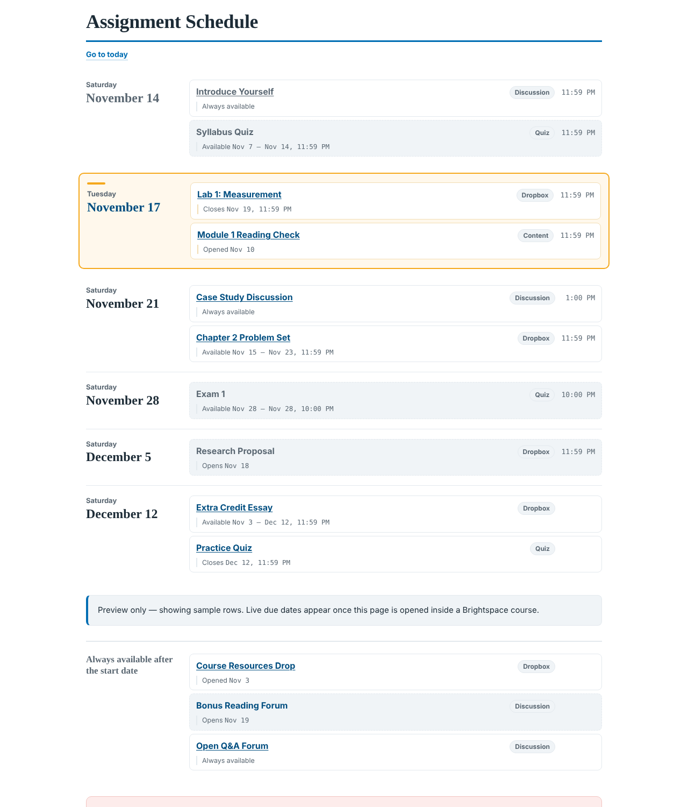

# 📄 Content Page Templates

Ready-made pages that instructors add to a course's **Content** area. They build themselves from the course's own data, so instructors never have to update them by hand.

Every template is a **single, self-contained HTML file**. It runs with the signed-in person's own Brightspace login, so each student sees only what they have access to.

> 📸 Screenshots show the template's built-in demo data, not a real course.

---

## 📑 Templates in This Folder

| Template | File |
|----------|------|
| [Automated Assignment Schedule](#automated-assignment-schedule) | `90_Automated_Assignment_Builder.html` |

---

## 🚀 Before You Start

Content templates must be uploaded to the **same folder as your other Content templates**, so instructors can pick them from the Content tool.

1. Find your template folder in **Admin Tools → Config Variable Browser**:
   ```
   d2l.Tools.Content.TemplatePath   (Org Unit)
   ```
   For example: `/shared/Content_Templates/`
2. Upload the template into that folder in **Admin Tools → Public Files**.
3. Instructors add it to a course from the Content tool's document templates (**Create a File → Browse Templates**).

The page detects which course it's in automatically. There's nothing to configure per course.

---

## Automated Assignment Schedule

**File:** `90_Automated_Assignment_Builder.html`



### What it does
Builds a **course schedule automatically**. It reads every activity with a due date from **Content, Assignments (Dropbox), Quizzes, and Discussions**, removes duplicates, and lists everything **grouped by due date**, with each item linking straight to the activity.

### Use it for
- A "Schedule of Activities" page that never goes out of date
- Helping students plan their week at a glance
- Saving instructors from rebuilding a schedule every time a due date changes

### How it works
- **Groups by due date**, sorted by date and then by name, with the due time on each item.
- The **next group due** is highlighted in an outlined box, with a "Go to what's due next" link at the top.
- Each item shows its **availability window** (always available, opens, closes, or both). Items that haven't opened yet or have already closed are shown but not linked.
- Assignments, quizzes, and discussions with **no due date** are listed in their own group at the bottom.
- The same assignment added to Content **and** found in its own tool appears only once.
- **Each student sees only what they have access to.** Items with unmet release conditions aren't listed, and a note at the bottom says so.
- Fully **ADA-compliant** HTML5 with screen reader support, and it prints cleanly.

### Settings (optional)
Everything worth changing is in the `CONFIG` block near the top of the script:

| Setting | Default | What it does |
|---------|---------|--------------|
| `heading` | `Assignment Schedule` | The page title |
| `scanContent` / `scanAssignments` / `scanQuizzes` / `scanDiscussions` | `true` | Which tools to read |
| `linkTarget` | `content` | Open items in the Content viewer, or in their own tool |
| `showPastItems` | `true` | Set to `false` to hide everything before today |
| `showNoDueDate` | `true` | List undated assignments, quizzes, and discussions at the bottom |
| `highlightNextDue` | `true` | Box the group that's due next |
| `availabilityStyle` | `compact` | `compact` (Oct 1 – Oct 4) or `sentence` (Availability starts on…) |
| `timeZone` | *(viewer's own)* | Force a zone, such as `America/Chicago`, if dates must match your college calendar |
| `openInNewTab` | `false` | Open activity links in a new tab |

---

<p align="center">
  Created by <strong>Jonathan Sorrenti</strong> · <a href="https://github.com/sponsors/jonsorr">❤️ Sponsor this project</a> · <a href="../README.md">Back to main README</a>
</p>
