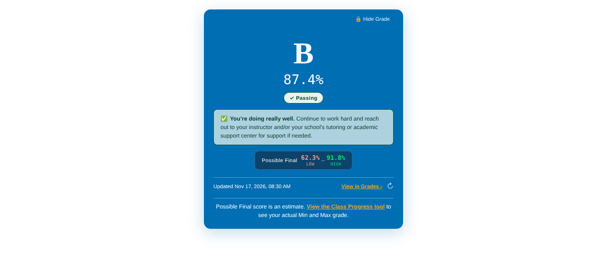
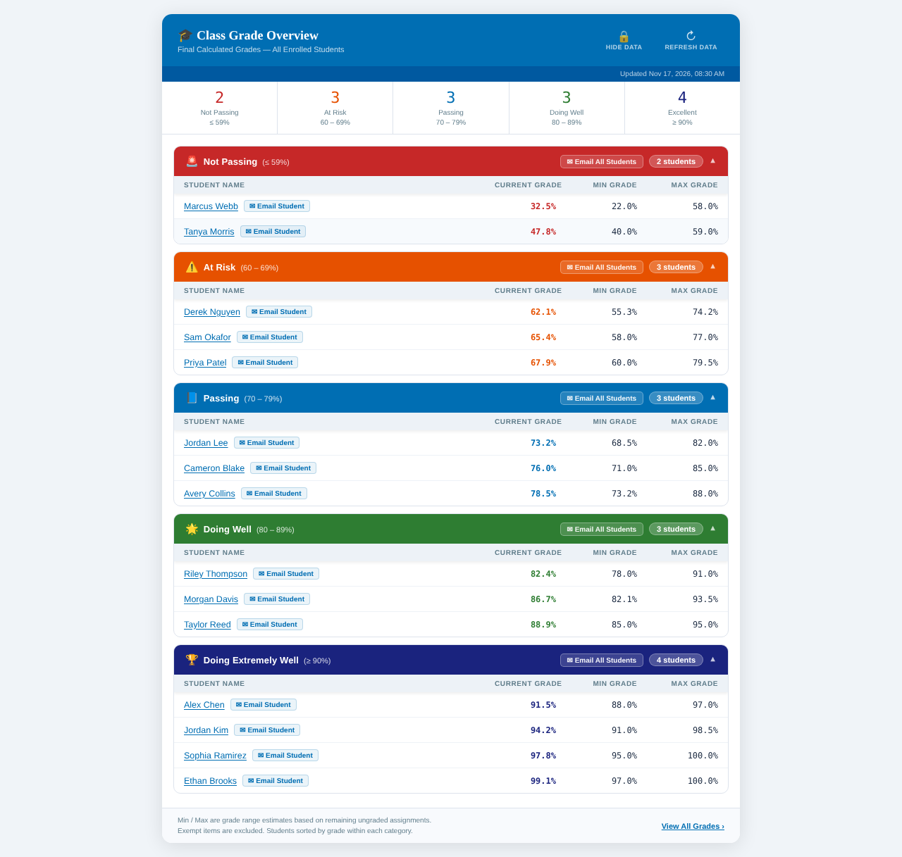
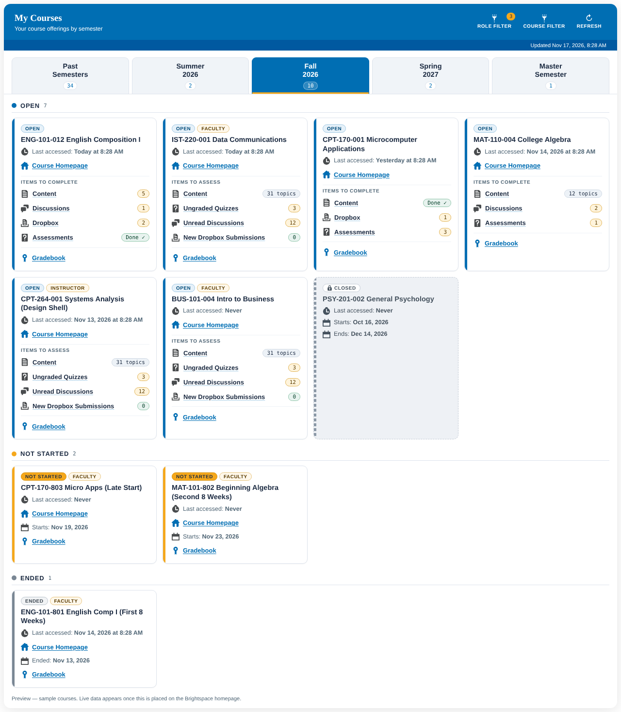
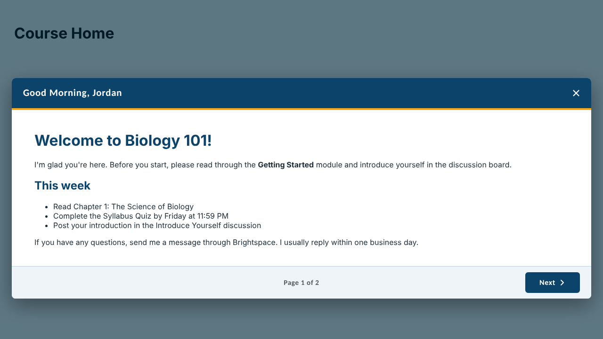
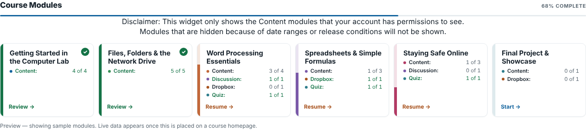

# 🏠 Course & Homepage Widgets

Student- and instructor-facing widgets that live on **Brightspace homepages**. They show grades, progress, courses, and announcements right where people land.

Every widget is a **single, self-contained HTML file**. It runs with the signed-in person's own Brightspace login, so there are no API keys, servers, or installs, and everyone sees only what they're allowed to see.

> 📸 Screenshots show the widgets' built-in demo data, not real students or courses.

---

## 📑 Widgets in This Folder

| Widget | File | Goes on |
|--------|------|---------|
| [Student Grade Widget](#student-grade-widget) | `d2l_grade_widget.html` | Course homepage |
| [Instructor Grade Widget](#instructor-grade-widget) | `d2l_instructor_grade_widget.html` | Course homepage |
| [My Courses Widget](#my-courses-widget) | `d2l_my_courses_widget.html` | Org (main) homepage |
| [Welcome Window](#welcome-window) | `d2l_welcome_window_widget.html` | Course homepage |
| [Visual Table of Contents](#visual-table-of-contents) | `visual-toc-widget.html` | Course homepage |

---

## 🚀 Before You Start

**Most widgets: upload the file, then point a custom widget at it**
1. Upload the file to a folder in **Admin Tools → Public Files**, for example `Course_Homepages`.
2. Go to **Admin Tools → Homepage Management → Widgets → Create Widget**.
3. Enter a name, open the **Content** tab, and click **Source Code** on the toolbar.
4. Add an `<iframe>` that points to the file:
   ```html
   <iframe src="/shared/Course_Homepages/d2l_grade_widget.html" style="width: 100%;" height="450" scrolling="no"></iframe>
   ```
5. Click **Save**, then **Save and Close**, and add the widget to your homepage layout.
6. Use **release conditions** on the widget to control which roles see it (for example, students see the Student Grade Widget and instructors see the Instructor Grade Widget).

Adjust the `height` to fit each widget.

**The Welcome Window is different.** You paste the whole file into the widget instead of using an iframe. See [Welcome Window](#welcome-window).

---

## Student Grade Widget

**File:** `d2l_grade_widget.html`



### What it does
Shows a student their **current grade** in the course, with a letter grade, a passing / at-risk / not-passing badge, and the **lowest and highest final grade** they can still earn.

### Use it for
- Helping students see where they stand without digging through the Grades tool
- Encouraging students to reach out for help early
- Reducing "what's my grade?" emails to instructors

### How it works
- Grade data stays hidden behind a **privacy screen** until the student clicks it, so grades aren't shown on a projector or shared screen by accident. Students can re-lock it.
- Short **encouraging messages** change with the grade and point students to support resources.
- A **"No Grades Yet"** state appears early in the term.
- Grades use the same points-based method as Brightspace, including weighted categories, drop rules, exempt and bonus items.

### Settings (optional)
In the `SITE` block near the top of the script:
- `supportName` and `supportUrl`: the tutoring or support center named in the messages. Leave `supportUrl` blank to show plain text.
- `passFailCourses`: course codes graded Successful / Unsuccessful instead of A–F.
- `gradebookOnlyPrefixes`: course code prefixes that should show only a link to the Gradebook.

> Students only see **released** grade items, so the minimum and maximum are estimates. The widget says so on screen.

---

## Instructor Grade Widget

**File:** `d2l_instructor_grade_widget.html`



### What it does
Gives instructors their **whole class at a glance**. Students are grouped into five performance groups (**Not Passing**, **At Risk**, **Passing**, **Doing Well**, and **Doing Extremely Well**), with each student's current, minimum, and maximum grade.

### Use it for
- Finding students who need outreach in seconds
- Sending a quick check-in email to one student or a whole group
- Tracking class performance without exporting the gradebook

### How it works
- Nothing loads until the instructor clicks **Reveal Grade Data** (privacy screen).
- **Email Student** and **Email All Students** buttons open a pre-written message. At-risk templates include a supportive note.
- Student names link to each student's Class Progress page.
- Numbers match Brightspace's **Class Progress** tool exactly.

### Settings (optional)
In the `SITE` block: `supportName` / `supportUrl` (named in the at-risk email templates), `passFailCourses`, and `gradebookOnlyPrefixes`.

---

## My Courses Widget

**File:** `d2l_my_courses_widget.html`



### What it does
A replacement **My Courses** widget for the **org (main) homepage**. Courses are organized into **Past Semesters, Last Semester, This Semester, Next Semester**, and a **Master Semester** tab, with cards showing what needs attention in each course.

### Use it for
- Helping students and faculty find this term's courses fast
- Showing items to complete or grade right on the homepage
- Hiding old and inactive courses without losing access to them

### How it works
- **Students** see items to complete (Content, Discussions, Dropbox, Quizzes) with progress.
- **Instructors** see items to grade (unread submissions, ungraded quiz attempts, unread discussion posts).
- **Role** and **status** filters, a refresh button, and quick links to each course's Content, Discussions, Dropbox, Quizzes, and Gradebook.
- Inactive courses are always hidden. **View All Courses** opens D2L's own All Courses window.
- Results are cached for a few minutes so the homepage loads instantly.

### Settings worth checking
In the `CONFIG` block near the top of the script:
- `termWindows`: the start/end dates that decide which term a course belongs to. Defaults: Spring Dec 15 – May 15, Summer May 1 – Aug 15, Fall Aug 15 – Dec 20.
- `defaultRoles`: the roles shown when the widget first loads (default: Student, Learner, Instructor, Faculty).
- `myCourses.widgetId` (optional): the id of your homepage's built-in D2L My Courses widget, so D2L's All Courses window can load its saved settings.

> 💡 Debug mode: add `#mcdebug` to the end of the homepage address to see why a course is or isn't showing.

---

## Welcome Window

**File:** `d2l_welcome_window_widget.html`



### What it does
Recreates Brightspace's **Welcome Window** as a pop-up on the course homepage. It shows students any **unread pages** in the course's **Announcements** Content module, one page at a time.

### Use it for
- Making sure students see important course announcements
- Welcome messages, weekly updates, and policy reminders
- Giving instructors a pop-up they control just by adding pages to Content

### How it works
1. The widget finds the top-level Content module named **Announcements**.
2. If any HTML pages in it are unread, a pop-up opens with a greeting ("Good Morning, Jordan").
3. **Next** and **Dismiss** mark each page as read. **Previous** goes back. **X** or **Esc** closes the window and leaves the current page unread.
4. When every page is read, nothing appears. The widget shows nothing on the homepage itself.

### How to install it (different from the other widgets)
1. Go to **Admin Tools → Homepage Management → Widgets → Create Widget**.
2. Open the **Content** tab, click **Source Code**, and **paste the entire file**.
3. In the widget's appearance settings, turn off the title and border if offered.
4. Add the widget to your course homepage layout.

Instructors don't configure anything. They add pages to a visible **Announcements** module, and the pop-up does the rest.

### Settings (optional)
- `moduleTitle` in the `SETTINGS` block: the Content module to read (default `Announcements`).
- Colors: find and replace the hex values listed in the styles comment to match your branding.

---

## Visual Table of Contents

**File:** `visual-toc-widget.html`



### What it does
Shows a course's Content modules as **visual tiles** with each student's **progress**, so students can see at a glance what's done and what's next.

### Use it for
- A friendlier course homepage than the standard Content list
- Helping students track their own progress module by module
- Giving online courses a clear, visual path through the material

### How it works
- Each tile shows the module's content, discussions, dropbox, and quiz items completed (for example, "3 of 4").
- Completed modules show a check mark, and buttons read **Start**, **Resume**, or **Review**.
- An overall "% complete" bar sits at the top.
- Only modules the student can see are shown. Hidden or restricted modules stay hidden.
- Built to **ADA / WCAG 2.1 AA** standards.

---

<p align="center">
  Created by <strong>Jonathan Sorrenti</strong> · <a href="https://github.com/sponsors/jonsorr">❤️ Sponsor this project</a> · <a href="../README.md">Back to main README</a>
</p>
