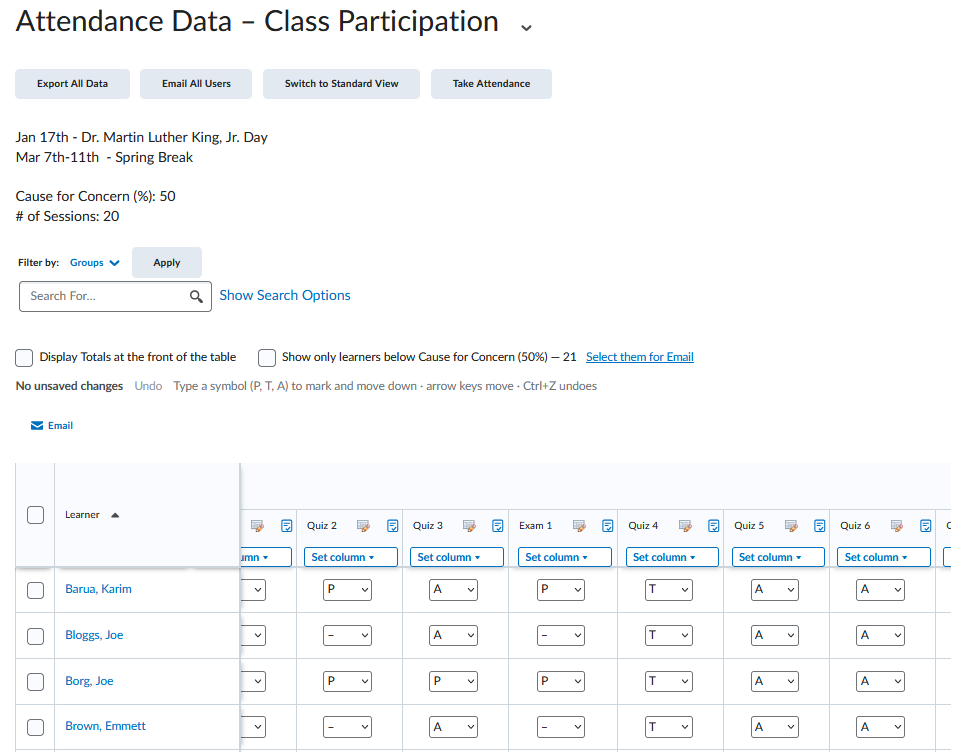
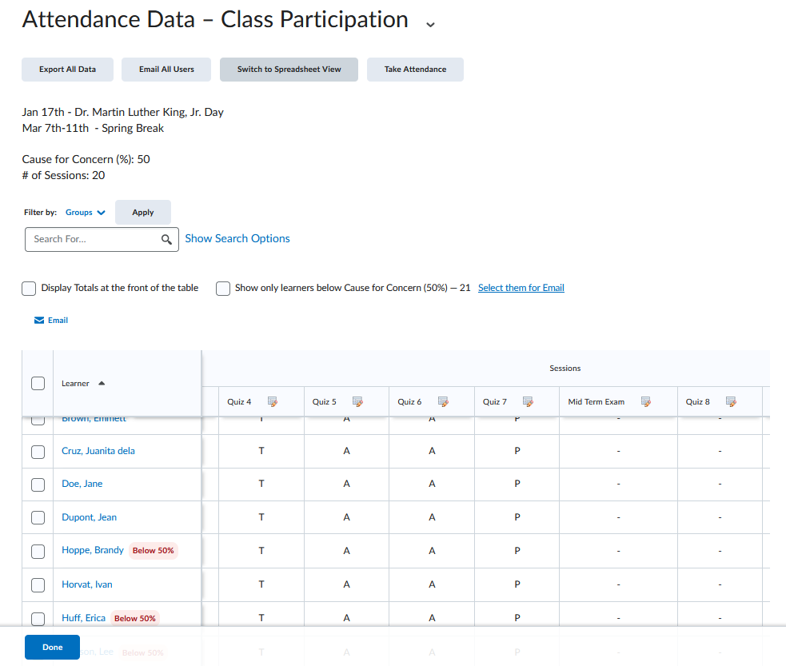
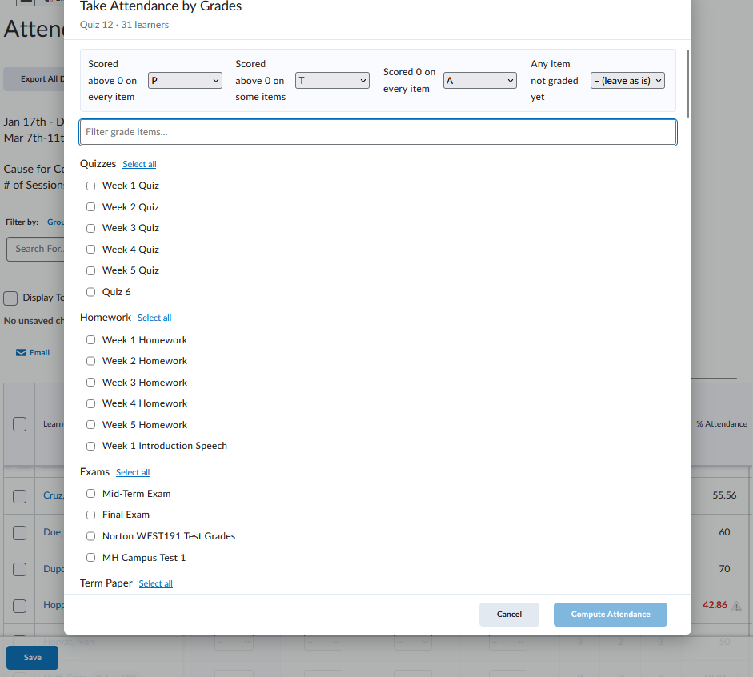
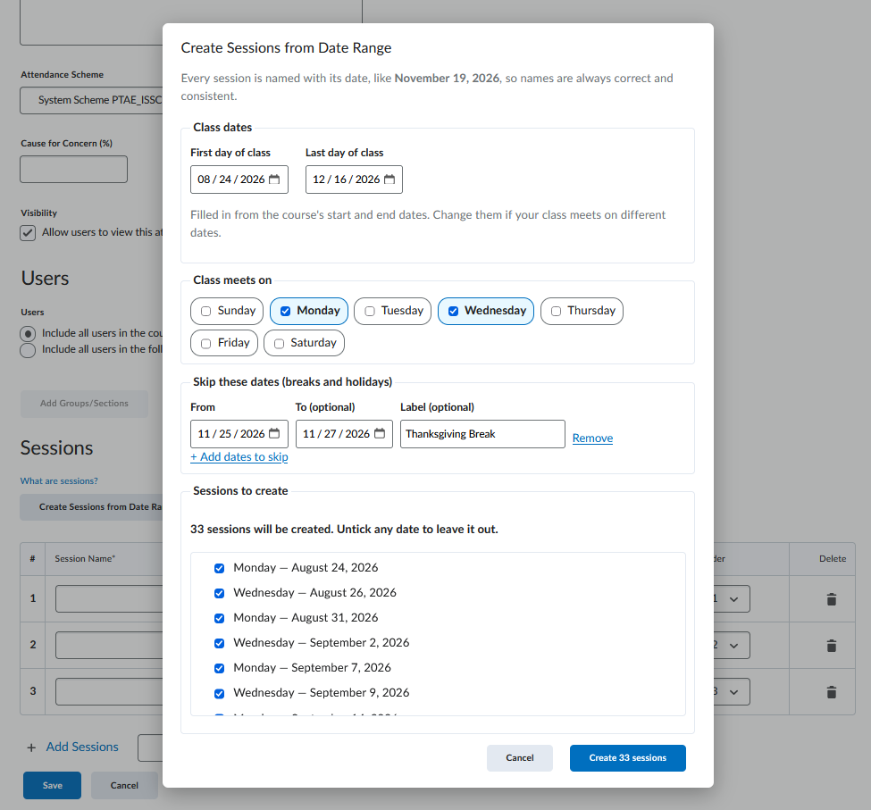
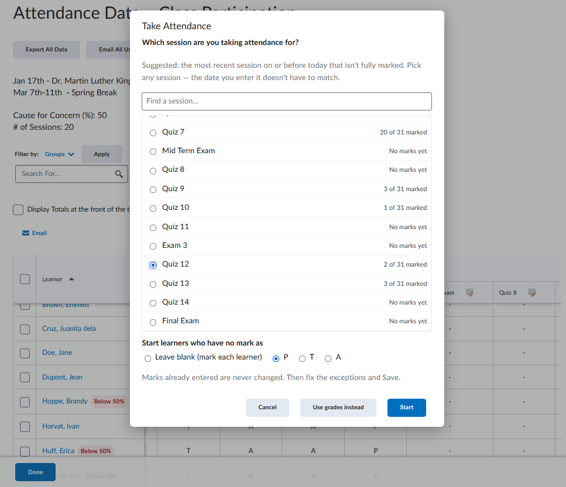

# 🧩 Custom Apps

Full upgrades to **Brightspace's built-in tools**. Instructors keep clicking the same navbar link and using the same tool, now with features D2L doesn't offer.

Every app is a **single, self-contained HTML file**. It runs inside your Brightspace site with the signed-in person's own login, so there are no API keys, servers, LTI registrations, or installs.

🏭 **Running live in production** in a college's Brightspace environment.

> 📸 Screenshots come from a test course with test learners, not real students.

---

## 📑 Apps in This Folder

| App | File |
|-----|------|
| 🆕 [Attendance Plus](#attendance-plus) | `attendance-plus.html` |

---

## 🚀 Before You Start

You need a Brightspace administrator who can:

| Need | Why |
|------|-----|
| Upload to **Admin Tools → Public Files** (`/shared/`) | The file must be served from your own Brightspace site so it can work with D2L's pages |
| Edit **Navigation & Themes** | To point the course navbar's link at the file |
| A **test course** with a test student | For the test checklist before you turn it on for everyone |

Instructors need only their **usual permissions**. Nothing new is granted, and each app can only do what the signed-in person can already do.

**Shared features**
- 🔁 **Drop-in replacements.** Each app takes over a built-in tool's navbar link. To roll back, point the link back at D2L's own tool.
- 🎓 **Students see nothing different.** D2L itself decides who gets the student view, so there are no role names to set up.
- 💾 **D2L still saves everything.** Changes are saved through D2L's own pages, so reports, exports, and Data Hub data sets are unchanged.
- ♿ **Accessible.** Everything the apps add is built to **WCAG 2.2 AA**.

---

## Attendance Plus

**File:** `attendance-plus.html` · **Version:** 1.6.0

### What it does
Makes Brightspace's **Attendance** tool work like the **Gradebook** for instructors, while every mark is still saved by D2L's own Attendance pages. Registers, schemes, New Register, More Actions, Edit Data, sorting, search, Export, and Email all stay exactly as D2L built them. Attendance Plus adds new features on top.

### Use it for
- Taking attendance for a whole class in seconds, right from the register page
- Working comfortably with long class lists and semesters full of sessions
- Filling attendance from participation grades instead of marking every learner by hand
- Spotting learners whose attendance has dropped below your Cause for Concern %
- Building a whole semester of sessions in seconds, each one named with its date

### ✨ What's new

#### 1. Scrollbars at the top and bottom
A second horizontal scrollbar sits **above** the table and stays in sync with the one below it, so you can move across sessions without scrolling to the bottom of a long class list first.

#### 2. Learners stay on the left
The **Learner** column (and its checkbox) stays put while you scroll right, so you always know whose row you're on.

#### 3. Sessions stay at the top
The **session headings** stay put while you scroll down, so you always know which session you're marking. Today's session is highlighted.

#### 4. Switch to Spreadsheet View
Take attendance **right from the main register page**, with no Edit Data page needed for each session:
- Every cell becomes a **dropdown** limited to that register's attendance scheme.
- **Set column** on any session: set everyone to a status, fill blanks only, or copy the previous session.
- **Keyboard entry:** type a symbol (like `P`) to mark a learner and move down. Arrow keys move between cells, and Delete clears a mark.
- **Undo** (or Ctrl + Z) reverses your last change or column fill.
- **All learners on one page:** Spreadsheet View switches D2L to its largest "per page" option.
- A running count shows your unsaved changes, and you're warned before leaving with unsaved marks.
- **Save** runs D2L's own Save for each session you changed.

#### 5. Display Totals at the front
A **Display Totals at the front of the table** checkbox moves the totals columns to the **left**, right next to the learners' names, so you don't have to scroll to the far right. Your choice is remembered.

#### 6. Take Attendance by Grades
Suggests attendance from the **grade items you choose**. It's available in two places:
- A **Take Attendance by Grades** button on each session's **Set Attendance Data** page
- A **grades icon** in every session heading in **Spreadsheet View**

Pick grade items (grouped by grade category, with a filter and **Select all**), then click **Compute Attendance**. Each learner gets a suggestion from these rules, which you can change:

| If the learner… | Default |
|-----------------|---------|
| Scored above 0 on **every** chosen item | **P** |
| Scored above 0 on **some** items | **T** |
| Scored 0 on **every** item | **A** |
| Has **any item not graded yet** | Leave as is |

You'll see a review table with each learner's score on each item. Change any row, or tick learners (Shift-click selects a range) and use **Set selected to…**. Then choose **Apply** or **Apply and Save**. Exempt items count as scored, and your rules and chosen items are remembered.

#### 7. 🆕 Create Sessions from Date Range
On the **New Register** and **Edit Register** pages, a **Create Sessions from Date Range** button builds every session for the term at once, each named with its date (for example, **August 24, 2026**).

- **Class dates:** the first and last day of class are **filled in from the course offering's Start and End Date**. Change them if your class meets on different dates. Next time, it remembers the dates you used for that course.
- **Class meets on:** tick the days of the week the class meets.
- **Skip these dates:** add breaks and holidays as a single date or a range, with an optional label such as "Thanksgiving Break." Your school can also pre-load its holidays for everyone (see `skipDates` in Settings).
- **Sessions to create:** a live preview lists every date with a running count. Untick any date to leave it out, then click **Create _N_ sessions**.
- **Any number of sessions:** D2L adds at most 100 session rows at a time, so Attendance Plus repeats that step automatically. Everything else you entered on the page is kept.
- **Safe on existing registers:** on Edit Register, new dates are added *after* the existing sessions. Existing sessions and their attendance are never renamed or removed, and dates already in the register are skipped. On a new register where you've already typed names, you choose whether to replace them or keep them.

Two more additions on the same pages:

- **A date picker beside every session name.** Pick a date and the name is filled in using the standard format.
- **Consistent date names.** Typed dates like `8/24/26` are turned into the standard format (for example, *August 24, 2026*) when you leave the box. On Save, any session name that isn't a date is flagged, with **Fix them** and **Save anyway** options. Consistent names make attendance easy to match by date, for example with a student information system. The format and how strict the check is are both settings.

### ➕ More add-ons

| Add-on | What it does |
|--------|--------------|
| **Take Attendance** | Pick **any** session (dates or names like "Week 1 Class 2"). The tool suggests one, starts every unmarked learner as **P**, and you fix the exceptions and Save. Marks already entered are never changed. Includes a **Use grades instead** option. |
| **At-risk flags** | Learners below the register's **Cause for Concern %** get a "Below X%" badge. Show only those learners, or click **Select them for Email** to message them. |
| **Safe saving** | After D2L saves, every change is checked and retried up to **3 times**. Anything still not saved stays marked in red, and **Copy details** puts a report on the clipboard for a help desk ticket. |
| **Unsaved-mark recovery** | Unsaved Spreadsheet View marks are kept in the browser for up to 7 days. Reopen the register and you're offered **Restore marks**. |
| **Bookmarklet pass-through** | Older attendance bookmarklets clicked on the page still run on the D2L page inside it. |

### How to install it
1. **Upload the file.** In **Admin Tools → Public Files**, upload `attendance-plus.html` to a folder, for example `/shared/CustomApps/`.
2. **Point the Attendance link at it.** In **Navigation & Themes**, create a **Custom Link** (or edit the one your course navbar uses for Attendance):
   - **URL:** `/shared/CustomApps/attendance-plus.html?ou={OrgUnitId}` (use your own folder)
   - **Behavior:** Same window
   - Replace the navbar's **Attendance** item with this link, and keep the name **Attendance**.
3. **Test it** with the checklist below, as an instructor and as a student (impersonation is fine).

Brightspace fills in `{OrgUnitId}` for each course. **To roll back,** point the navbar item back at D2L's built-in Attendance link.

### Settings (optional)
Everything is in the `SETTINGS` block at the top of the file's script. Change a value, save, and re-upload. These are the defaults:

| Setting | Default | What it does |
|---------|---------|--------------|
| `features.spreadsheetView` | `true` | The Switch to Spreadsheet View button |
| `features.totalsFirstOption` | `true` | The "Display Totals at the front of the table" checkbox |
| `features.frozenPanes` | `true` | Frozen learner column and headings, plus the top scrollbar |
| `features.takeAttendance` | `true` | The Take Attendance button |
| `features.attendanceByGrades` | `true` | Take Attendance by Grades (button and Spreadsheet View icons) |
| `features.atRiskFlags` | `true` | Flags learners below the register's Cause for Concern % |
| `features.draftRecovery` | `true` | Keeps unsaved Spreadsheet View marks in the browser until saved |
| `features.showMostLearnersPerPage` | `true` | Uses D2L's biggest "per page" option in Spreadsheet View and on Set Attendance Data |
| `features.sessionsFromDates` | `true` | The Create Sessions from Date Range button on New/Edit Register |
| `features.sessionDatePickers` | `true` | A date picker beside every session name on New/Edit Register |
| `features.prefillCourseDates` | `true` | Starts Create Sessions from Date Range with the course offering's Start and End Date |
| `features.bookmarkletPassThrough` | `true` | Lets older bookmarklets run on the D2L page inside |
| `labels.*` | English button names | The wording of every added button and checkbox |
| `totalsFirstDefault` | `false` | Where the totals start for someone who has never changed it |
| `takeAttendanceStartWith` | `'P'` | The status Take Attendance gives unmarked learners (`''` = leave blank) |
| `gradeRuleDefaults` | P / T / A / leave as is | The starting grade rules: every item / some / none / any ungraded |
| `atRiskDefaultPercent` | `null` | Threshold for registers with no Cause for Concern % (`null` = no flags) |
| `draftKeepDays` | `7` | How long unsaved marks are offered back |
| `saveAttempts` | `3` | Automatic save tries per session before reporting a problem |
| `sessionNames.format` | `'MMMM D, YYYY'` | The date format for session names (*August 24, 2026*). Tokens: `dddd ddd MMMM MMM MM M DD D YYYY YY` |
| `sessionNames.autoFormat` | `true` | Turns typed dates like `8/24/26` into that format when you leave the box |
| `sessionNames.check` | `'warn'` | On Save, flags names that aren't dates: `'off'`, `'warn'` (can Save anyway), or `'require'` (must fix) |
| `skipDates` | `[]` | College-wide holidays pre-filled (and removable) in Create Sessions from Date Range, e.g. `[{ from: '2026-11-25', to: '2026-11-27', label: 'Thanksgiving Break' }]` |

Each person's own choices (Totals position, grade rules, chosen grade items, class days, and skipped dates) are remembered in their browser and override these defaults for them.

### Test checklist
Run these in a test course, in Chrome and Firefox, before turning it on for everyone:

- [ ] As an instructor, Attendance opens the registers list. Schemes, New Register, and More Actions work as before.
- [ ] Impersonating a student, Attendance opens My Attendance.
- [ ] On a register, the Learner column and headings stay put while scrolling both ways.
- [ ] Display Totals at the front moves the totals and is remembered.
- [ ] Switch to Spreadsheet View shows all learners on one page.
- [ ] Change cells in two sessions, Save, then confirm on each session's Edit Data page.
- [ ] Take Attendance on a blank session starts everyone as P. Fix two learners and Save.
- [ ] Take Attendance by Grades fills a column, and Undo reverses it.
- [ ] Make a change, close the tab, and reopen the register: the unsaved marks are offered back.
- [ ] Set a Cause for Concern % on the register: learners below it are flagged.
- [ ] Sorting, search, the Sections filter, Export All Data, and Email still work.
- [ ] On New Register, Create Sessions from Date Range fills in the course's start and end dates.
- [ ] Pick class days and a skipped break: the preview leaves those dates out, and Create fills the session names.
- [ ] Create more than 100 sessions on a test register: the extra rows are added automatically and the other fields are kept.
- [ ] On Edit Register, new dates are added after the existing sessions, and dates already in the register are skipped.
- [ ] Type `8/24/26` as a session name and leave the box: it changes to the standard format.
- [ ] Save with a session name that isn't a date: you're offered Fix them or Save anyway.
- [ ] The next day, the Attendance data sets in Data Hub show the test marks.

### Good to know
- **How saving works:** Save runs D2L's own Save on each session's Set Attendance Data page, out of sight. It waits for D2L to finish setting up the page, saves, opens the session again to confirm every value stuck, and retries any that didn't.
- **Built on D2L's pages, not an API.** D2L has no Attendance API, so Attendance Plus works with D2L's own Attendance pages. If D2L redesigns the tool, the file may need an update. D2L's pages keep working underneath either way.
- **Grades are read with the signed-in person's access.** Take Attendance by Grades reads grade items through Brightspace's API using the person's own session, so it needs their normal Grades access in that course.
- Column tools and grade suggestions act on the learners shown on the page. Spreadsheet View switches to D2L's largest per-page option (250 on the register page, 200 on Set Attendance Data).
- Unsaved marks are kept only in that browser.

### Troubleshooting

| Symptom | Likely cause | Fix |
|---------|--------------|-----|
| The link opens a blank page or an error | `?ou={OrgUnitId}` is missing from the navbar link | Re-check install step 2 |
| Students see the instructor view | Their role has instructor-level Attendance permissions | Check the role's Attendance permissions |
| Some marks show "not saved" | D2L refused them, often because of a section filter on Set Attendance Data | Clear the filter and Save again, or use **Copy details** |
| Spreadsheet View still shows page 1 of 2 | An older file version | Upload the latest file (1.5.0 or later) |
| No at-risk flags | The register has no Cause for Concern %, or the totals are collapsed | Set the % on the register, expand the totals, or set `atRiskDefaultPercent` |
| Grade items don't load | The person lacks Grades access in that course | Check the role's Grades permissions |
| First and last day of class aren't filled in | The course offering has no Start or End Date set | Pick the dates in the dialog, or set them in Course Offering Information |
| "D2L didn't add the extra session rows" | D2L didn't respond to the request for more rows | Click **Add Sessions** to add the rows shown, then run Create Sessions from Date Range again |
| Groups/sections are cleared after creating sessions | Adding rows reloads the page, and D2L can't restore group selections | Re-add the groups, or Save the register first and then create the sessions (you're warned before this happens) |

### Credits
- **Attendance Plus** by Jonathan Sorrenti.
- **Take Attendance by Grades** is based on code from "D2L Attendance From Participation" by Henry Ecker, updated and revamped by Jonathan Sorrenti to work inside any D2L instance without extra pages or plugins.
- **Create Sessions from Date Range** is based on code from "D2L Attendance Register Generator" by Henry Ecker, updated and revamped by Jonathan Sorrenti to work inside any D2L instance without extra pages or plugins.

---

  Created by <strong>Jonathan Sorrenti</strong> · <a href="https://github.com/sponsors/jonsorr">❤️ Sponsor this project</a> · <a href="../README.md">Back to main README</a>

