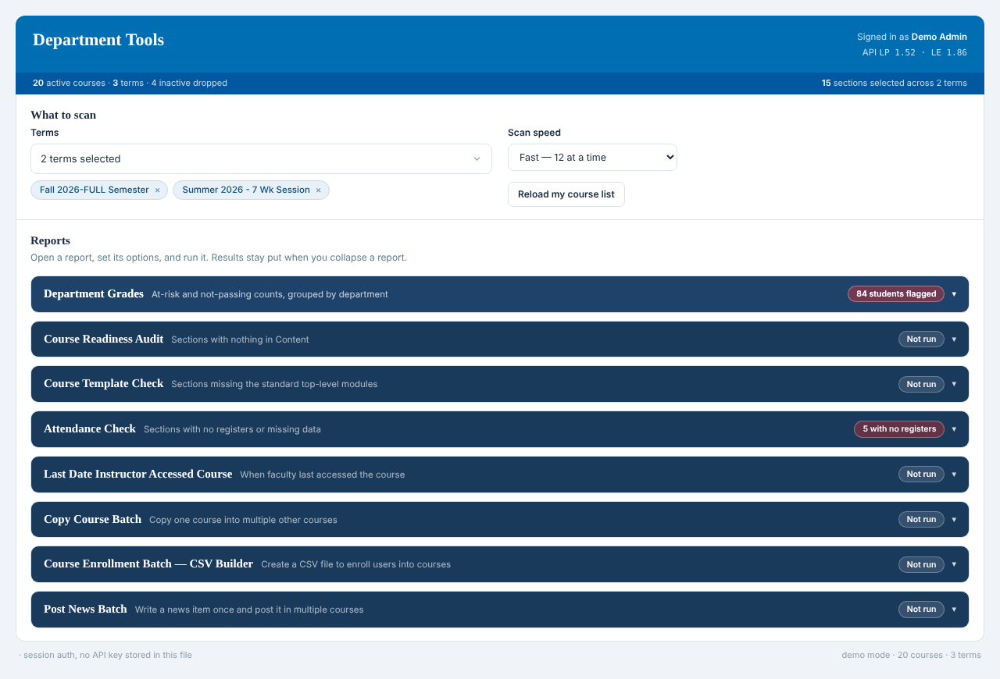
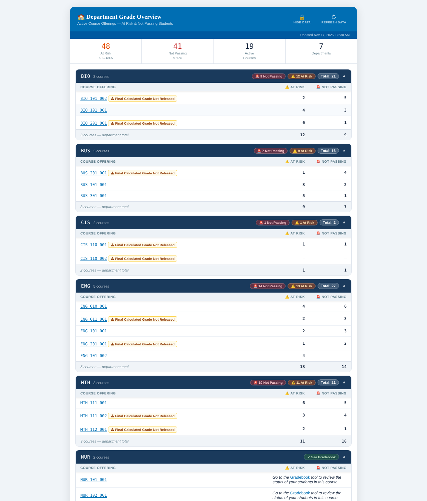
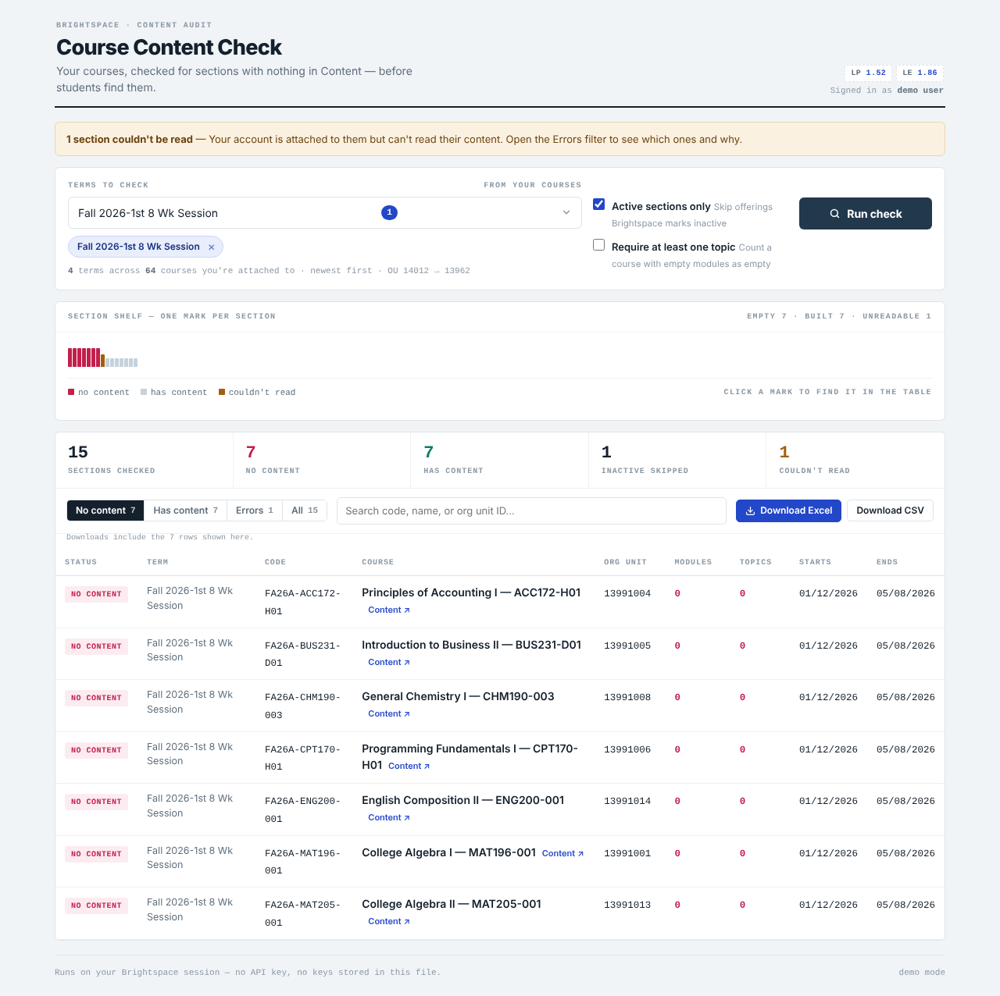
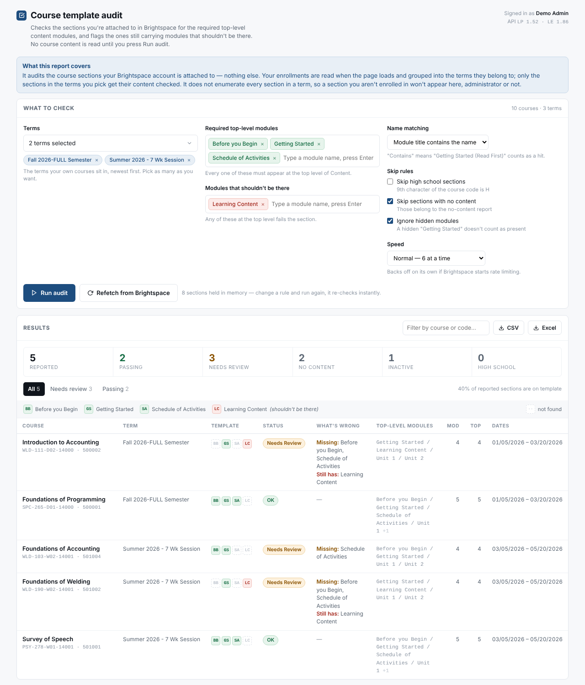
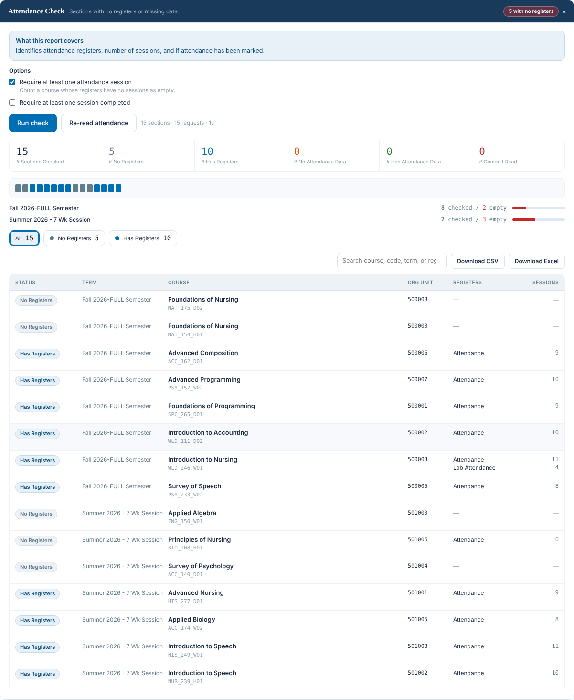
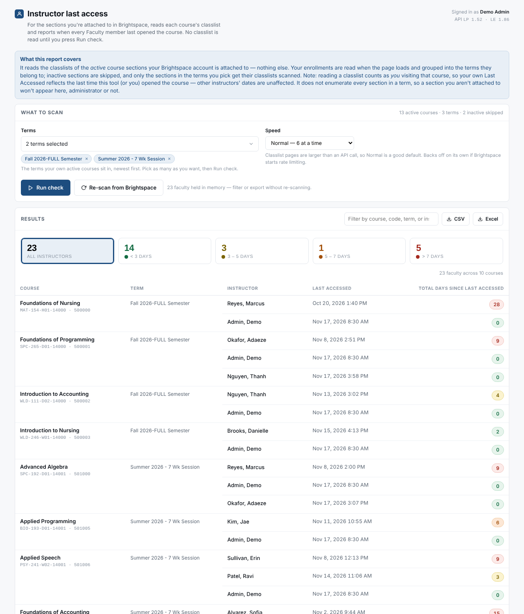
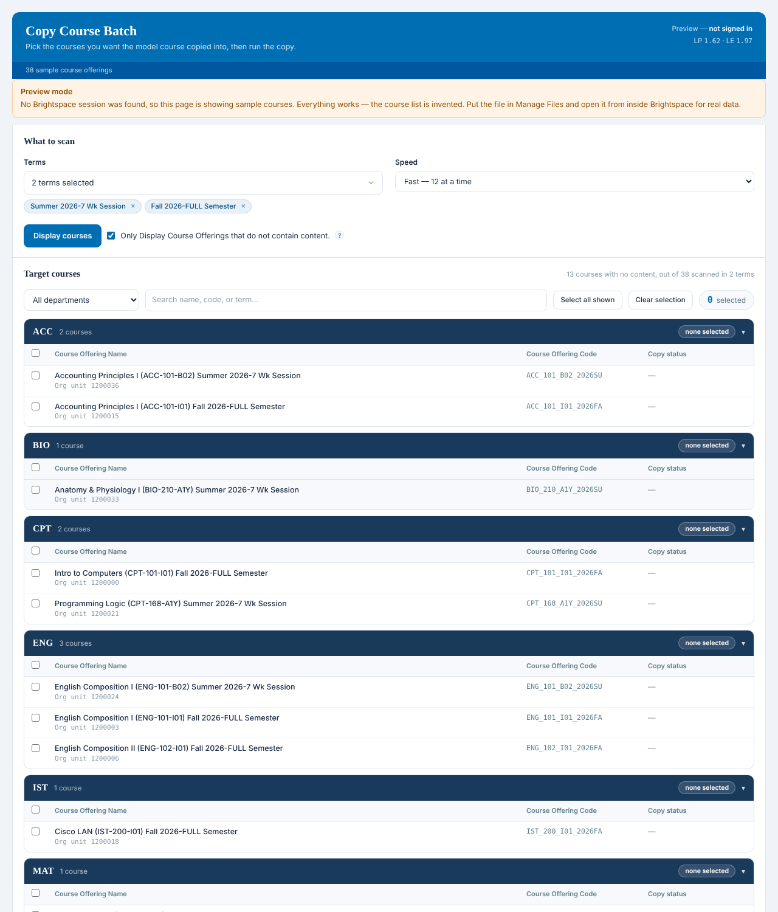
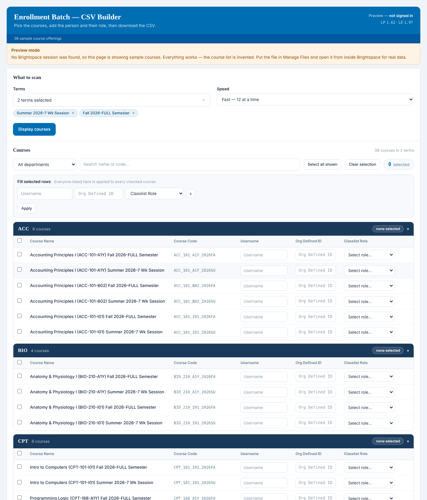
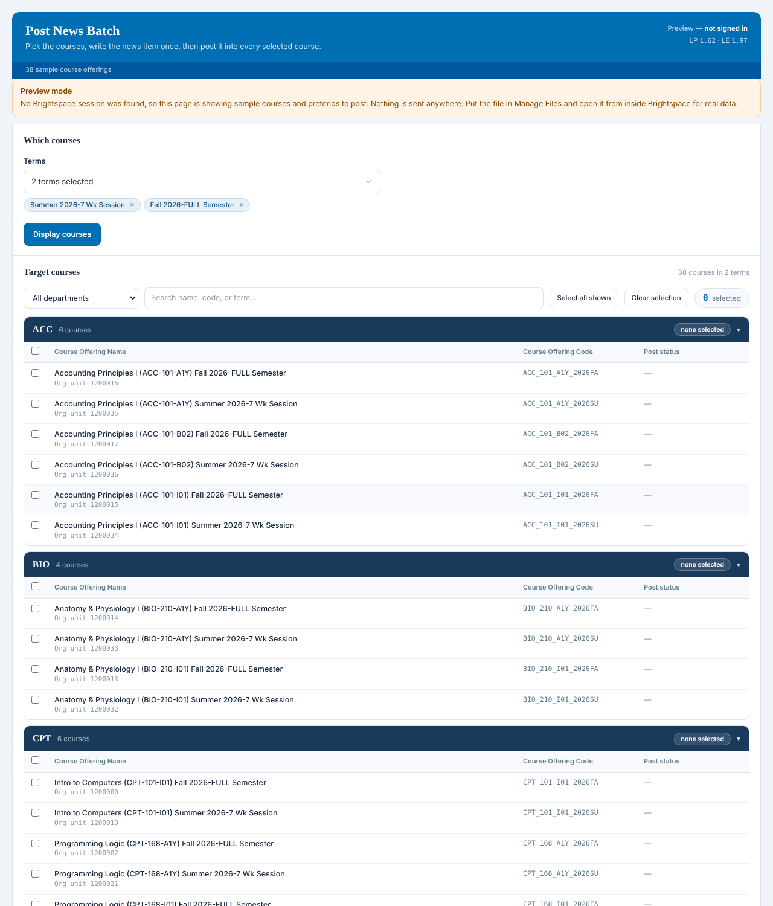

# 🏫 Department Tools

Reports and batch tools for **deans, department chairs, program coordinators, and LMS staff**. They answer questions like "Which courses are empty?", "Which instructors haven't logged in?", and "Which students are at risk?", and they handle jobs like copying, enrolling, and posting news across many courses at once.

Every tool is a **single, self-contained HTML file**. It runs inside your Brightspace site with your existing login, so there are no API keys, servers, or installs.

> 📸 Screenshots show the tools' built-in demo data, not real students or courses.

---

## 📑 Tools in This Folder

| Tool | File |
|------|------|
| ⭐ [Department Tools Dashboard](#-department-tools-dashboard) | `department-dashboard.html` |
| [Department Grades](#department-grades) | `d2l_dean_grade_widget.html` |
| [Course Readiness Audit](#course-readiness-audit) | `course-content-check.html` |
| [Course Template Audit](#course-template-audit) | `course-template-audit.html` |
| [Attendance Check](#attendance-check) | `course-attendance-check.html` |
| [Last Date Instructor Accessed](#last-date-instructor-accessed) | `course-instructor-access.html` |
| [Copy Course Batch](#copy-course-batch) | `course-copy-batch.html` |
| [Enrollment Batch CSV Builder](#enrollment-batch-csv-builder) | `course-enrollment-batch.html` |
| [Post News Batch](#post-news-batch) | `course-news-batch.html` |

---

## 🚀 Before You Start

1. **Upload the files** to a folder in **Admin Tools → Public Files**, for example `Department_Tools`.
2. **Open a tool** from its URL while signed in to Brightspace:
   `https://YOUR-BRIGHTSPACE-URL/shared/Department_Tools/department-dashboard.html`
3. **Share it with the right people.** Add the links to a custom navbar link or homepage widget, and use release conditions to control which roles see them. See the [main README](../README.md#2-upload-it-to-d2l-brightspace).

**How these tools find courses:** every tool reads **the signed-in person's own enrollments**, then builds a term picker from the semesters those courses belong to. A dean or chair sees the sections they're attached to in Brightspace. Nothing is scanned until you pick terms and click **Run** (or **Display courses**).

**Shared features**
- 🔑 **Your login, your permissions.** No API keys and no special org-structure permissions needed.
- 🗂️ **Grouped by department.** The department code is taken from the course code (for example `CPT_101_001` → `CPT`).
- ⚡ **Fast and polite.** Up to 12 requests run at once, with automatic slow-down and retry when Brightspace asks.
- 📥 **Review, then download.** Results show on the page first, with CSV or Excel downloads.
- 👀 **Demo mode.** Open a file straight from your computer to preview it with sample data.

### ⚙️ Settings worth checking
Each file has a `CONFIG` block near the top of its script. Most defaults work anywhere, but these are specific to your institution:

| Setting | Found in | What to set |
|---------|----------|-------------|
| `requiredModules` / `forbiddenModules` | Template Audit, Dashboard | The top-level module names your course template requires or no longer allows |
| `instructorRoles` | Instructor Access, Dashboard | The classlist role name(s) your instructors use (default: `Instructor`, `Faculty`) |
| `roles` / `enrollRoles` | Enrollment Batch, Dashboard | Your Brightspace role names, spelled exactly as they appear in Brightspace |
| `mailTo` / `enrollMailTo` | Enrollment Batch, Dashboard | Optional: who the Email button addresses |
| `passFailCourses` / `gradebookOnlyPrefixes` | Department Grades, Dashboard | Optional: course codes graded Successful/Unsuccessful, or that should show only a Gradebook link |

---

## ⭐ Department Tools Dashboard

**File:** `department-dashboard.html`



### What it does
Puts **all 8 department tools on one page**. It scans your courses and terms **once** at the top, and every report below shares that scan, instead of each report scanning the same courses again.

### Use it for
- A one-stop page for deans and chairs at the start of every term
- Running several reports on the same set of courses without waiting for repeat scans
- Giving department leaders one link instead of eight

### How to use it
1. Pick your **Terms** at the top. The course list loads once.
2. Open any report, set its options, and click its **Run** button.
3. Results stay in place when you collapse and reopen a report, so nothing has to be run twice.

### Good to know
- Every tool below also works as its own standalone page. Use whichever fits your users.
- Reports share data where they can. For example, Copy Course Batch reuses the content scan from the Course Readiness Audit.
- A greyed-out Run button shows a tip explaining why (for example, "You must first select a term at the top of the page").

---

## Department Grades

**File:** `d2l_dean_grade_widget.html`



### What it does
Shows every **active course** in a department with the number of **at-risk** and **not-passing** students in each, grouped by department code.

### Use it for
- Spotting struggling sections early enough to help
- Giving deans and chairs a term-wide grade picture without opening every gradebook
- Seeing which courses haven't released final grades yet

### How to use it
1. Open the page and click **Reveal Grade Data**. Nothing loads until you ask, which keeps grades private on shared screens.
2. Review the totals at the top and the course-by-course counts below.

### Good to know
- Grades are calculated from graded work only, with exempt items excluded, using the same points-based method Brightspace uses.
- Items Brightspace flags as excluded but still counts (common with External Learning Tool items) are handled so the numbers match Brightspace.
- **Optional settings** in the `SITE` block: `passFailCourses` (graded Successful/Unsuccessful) and `gradebookOnlyPrefixes` (show a Gradebook link instead of counts).
- Can also be placed in a homepage widget with an `<iframe>`.

---

## Course Readiness Audit

**File:** `course-content-check.html`



### What it does
Finds course sections with **nothing in the Content tool**.

### Use it for
- Catching empty courses **before students arrive**
- Following up with instructors who haven't built their course yet
- Checking that course copies actually landed

### How to use it
1. Pick one or more **terms**.
2. Choose your options (active sections only, or require at least one topic), then click **Run check**.
3. Filter by status, search, and download the results as Excel or CSV.

### Good to know
- A module with no topics counts as "has content" by default. Turn on **Require at least one topic** to count those as empty.
- Each course name links straight to its Content page.

---

## Course Template Audit

**File:** `course-template-audit.html`



### What it does
Checks each course's Content area for the **top-level modules your course template requires**, and flags **outdated modules** that shouldn't be there.

### Use it for
- Confirming every section follows your institution's template
- Finding courses still using an old template layout
- Quality reviews before the term starts

### How to use it
1. Pick one or more **terms**.
2. Enter the **Required top-level modules** and the **Modules that shouldn't be there** (type a name and press Enter).
3. Choose **Name matching**: "contains" or "exact."
4. Click **Run audit**, then filter and download the results.

### Good to know
- **Set your defaults:** edit `requiredModules` and `forbiddenModules` in the `CONFIG` block so the page opens with your template's module names.
- Optional skip rules: sections with no content, hidden modules, and high school sections (9th course-code character is `H`, off by default). Inactive sections are always skipped.
- No course content is read until you click **Run audit**.

---

## Attendance Check

**File:** `course-attendance-check.html`


*Shown inside the Department Tools Dashboard. The standalone page has the same options and results.*

### What it does
Scans each course's **Attendance** tool and reports whether it has **registers**, how many **sessions** each register has, and whether attendance is actually being **marked**.

### Use it for
- Finding courses that haven't set up attendance
- Checking that attendance is being taken, not just set up
- Supporting attendance or financial aid reporting requirements

### How to use it
1. Pick one or more **terms**.
2. Choose your options:
   - **Require at least one attendance session** counts a register with no sessions as empty.
   - **Require at least one session completed** checks for real P / A / T marks.
3. Click **Run check**, then filter, search, and download.

### Good to know
- Each status links to that course's Attendance tool.
- Courses with more than one register list each register and its session count.

---

## Last Date Instructor Accessed

**File:** `course-instructor-access.html`



### What it does
Reports the **last date each instructor accessed each course**, sorted into color-coded groups: **< 3 days**, **3–5 days**, **5–7 days**, and **> 7 days**.

### Use it for
- Making sure instructors are active in their online courses
- Following up on sections that haven't been visited
- Supporting regular and substantive interaction checks

### How to use it
1. Pick one or more **terms** and click **Run check**.
2. Click a color group to filter the list, or search by course, term, or instructor.
3. Download the results as CSV or Excel.

### Good to know
- **Set your instructor role:** edit `instructorRoles` in the `CONFIG` block to match your classlist role name (default: `Instructor` and `Faculty`).
- Handles large combined course shells by paging through the full classlist.
- ⚠️ Reading a classlist counts as **you** visiting that course, so **your own** "last accessed" date shows today. Every other instructor's date is accurate.

---

## Copy Course Batch

**File:** `course-copy-batch.html`



### What it does
Copies one **model course** (or course template) into **many course offerings** in a single run.

### Use it for
- Loading a master course into every section of a course
- Setting up a new term's sections from a standard shell
- Replacing a manual one-at-a-time copy process

### How to use it
1. Pick a **term** and click **Display courses**.
2. Enter the **Source Model Course Org Unit ID**. The tool shows the model's name so you can confirm it.
3. Check the target courses (filter by department or search).
4. Click **Copy to Courses** and confirm. A progress window shows each course's status.

### Good to know
- ✅ **Only Display Course Offerings that do not contain content** is on by default, so you don't copy on top of finished work.
- ⚠️ A copy **adds** to existing content; it doesn't replace it. There's no undo.
- ⚠️ Stay on the page until every copy has finished.
- Copies run 3 at a time, and each course's status is tracked until it completes.

---

## Enrollment Batch CSV Builder

**File:** `course-enrollment-batch.html`



### What it does
Builds a ready-to-upload **ENROLL CSV** for Brightspace's **Bulk User Management (BUM)** tool. You pick the courses, enter the people, and choose their roles.

### Use it for
- Adding tutors, librarians, coaches, or TAs to many courses at once
- Preparing enrollment files without building a spreadsheet by hand
- Sending a clean file to your LMS team for upload

### How to use it
1. Pick a **term** and click **Display courses**.
2. Check a course, then type a **Username** and **Org Defined ID** and choose a **Classlist Role**.
3. Use **+** to add more people to the same course, or use **Fill selected rows** to apply a list of people to every checked course.
4. Click **Download CSV** (or **Email** to open a draft).

### Good to know
- **Set your roles:** edit `roles` in the `CONFIG` block. Role names go into the CSV exactly as written, so they must match Brightspace.
- CSV format, one line per person per course, no header row:
  ```
  ENROLL,Username,Org Defined ID,Role Name,Org Unit Code
  ```
- Rows missing information are outlined in red and block the download until fixed.
- Optional: set `mailTo` for the Email button, and `orgDefinedIdPattern` to check ID formats.
- This tool doesn't change anything in Brightspace. It only builds the file.

---

## Post News Batch

**File:** `course-news-batch.html`



### What it does
Lets you write **one news item** (announcement) and post it into **many courses** at the same time.

### Use it for
- Department-wide announcements to every section
- Policy reminders, deadlines, or event notices
- Posting the same message without copying and pasting into each course

### How to use it
1. Pick a **term** and click **Display courses**, then check the target courses.
2. Enter a **Title**, optional **Start date** and **End date**, and write the message in the rich-text editor.
3. Post. Each course shows its own status.

### Good to know
- The editor includes formatting, colors, an HTML source view, and cleanup for text pasted from Word.
- Safe to re-run: courses that already have a news item with the same title are skipped, so nothing is posted twice.

---

<p align="center">
  Created by <strong>Jonathan Sorrenti</strong> · <a href="https://github.com/sponsors/jonsorr">❤️ Sponsor this project</a> · <a href="../README.md">Back to main README</a>
</p>
