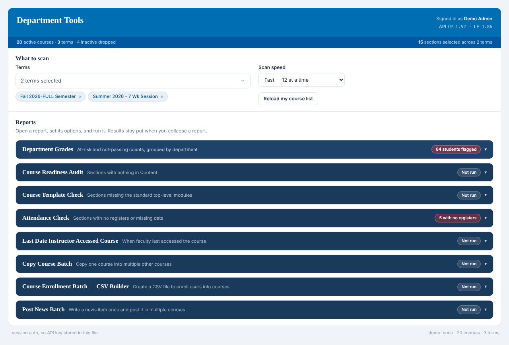

# D2L Brightspace APIs 🛠️

**Free, ready-to-use tools for D2L Brightspace — just download, upload, and go.**

[](https://github.com/sponsors/jonsorr)
[](https://github.com/jonsorr/D2L_Brightspace_APIs/blob/main/LICENSE)


Every tool in this repository is a **single, self-contained HTML file** that runs inside your Brightspace site using the **Brightspace (Valence) API**. Upload the file, open it, and it works with your existing Brightspace login. You don't need a server, an install, an API key, or a developer.

<p align="center">
  <br>
  <sub>The Department Tools Dashboard: 8 reports and batch tools sharing a single course scan (demo data).</sub>
</p>

🌐 **Website:** [jonsorr.github.io/D2L_Brightspace_APIs](https://jonsorr.github.io/D2L_Brightspace_APIs/)

**Jump to a folder:** [🔧 Admin Tools](Admin_Tools/) · [🏫 Department Tools](Department_Tools/) · [🏠 Homepage Widgets](Course_Homepages/) · [📄 Content Page Templates](Content_Templates/)

---

## 📑 Table of Contents

- [Why These Tools?](#-why-these-tools)
- [Proven in Production](#-proven-in-production)
- [Available Tools](#-available-tools)
- [Quick Start](#-quick-start)
- [Configuration](#-configuration)
- [Permissions](#-permissions)
- [Security & Privacy](#-security--privacy)
- [Troubleshooting](#-troubleshooting)
- [Roadmap](#-roadmap)
- [Support This Project](#-support-this-project)
- [Contributing](#-contributing)
- [About the Author](#-about-the-author)
- [License](#-license)
- [Disclaimer](#-disclaimer)

---

## 💡 Why These Tools?

Brightspace is powerful, but many everyday admin and course tasks still mean clicking through hundreds of screens, waiting on support tickets, or paying for vendor add-ons and custom development. That can cost a school **thousands of dollars a year** in licenses and staff time.

These tools handle many of those jobs for free:

- ✅ **No cost.** Free for every institution, forever.
- ✅ **No setup.** One HTML file per tool, with no servers or installs.
- ✅ **No API keys.** Each tool uses your existing Brightspace session.
- ✅ **No coding required.** Most tools work as-is or need a one-line change.
- ✅ **Transparent.** All code is open, readable, and yours to review.

---

## 🏭 Proven in Production

These aren't experiments or demos. **Every tool listed below is running live in a production Brightspace environment at a college**, doing real work for staff, faculty, and students every day. The versions published here are the same code, with each institution-specific value (email domains, role names, template modules, term dates) moved into a setting you can change.

| | |
|---|---|
| 🧰 **Tools running live in production** | 21 |
| ⚡ **Largest bulk run designed for** | 50,000+ course offerings in a single pass |
| 📚 **Largest course list handled** | 100,000+ courses loaded and paged in the browser |
| 🔑 **API keys required** | 0 |

---

## 🧰 Available Tools

> ✅ **All 21 tools are available now.** Click a tool's name for screenshots, setup steps, and settings, or click its file name to view and download the code.

### 🔧 [Admin Tools](Admin_Tools/)
*Bulk tools for LMS administrators: change thousands of records in minutes instead of days.*

| Tool | File | What it does |
|------|------|--------------|
| **[Summary Notification Settings Updater](Admin_Tools/README.md#summary-notification-settings-updater)** | [`d2l_notification_updater.html`](Admin_Tools/d2l_notification_updater.html) | Paste a list of usernames and bulk-update their Summary Notification settings, with parallel workers for very large lists |
| **[Correct User Emails](Admin_Tools/README.md#correct-user-emails)** | [`d2l_correct_user_emails.html`](Admin_Tools/d2l_correct_user_emails.html) | Stop bounce-backs by correcting user email addresses in bulk based on each user's role |
| **[Adjusted Grade Config Updater](Admin_Tools/README.md#adjusted-grade-config-updater)** | [`adjusted-grade-config-update.html`](Admin_Tools/adjusted-grade-config-update.html) | Bulk-change a course-level config variable override (set by default for Release Adjusted Final Grade) across 50,000+ courses, with preview mode and a one-course test run |
| **[Create Org Units](Admin_Tools/README.md#create-org-units)** | [`d2l_create_org_units.html`](Admin_Tools/d2l_create_org_units.html) | Create Departments, Course Templates, and Course Offerings in bulk |
| **[Set Active Status](Admin_Tools/README.md#set-active-status)** | [`d2l_set_active_status.html`](Admin_Tools/d2l_set_active_status.html) | Set Courses Active or Inactive in bulk, and clean up unused Divisions, Departments, Templates, and Semesters; built to handle 100,000+ courses |
| **[Delete Groups](Admin_Tools/README.md#delete-groups)** | [`d2l_delete_groups.html`](Admin_Tools/d2l_delete_groups.html) | Clean up thousands of groups and group categories, deleting a group only after checking that no Content, Quiz, Discussion, or Assignment uses it |

### 🏫 [Department Tools](Department_Tools/)
*Reports and batch tools for deans, department chairs, and program coordinators.*

| Tool | File | What it does |
|------|------|--------------|
| ⭐ **[Department Tools Dashboard](Department_Tools/README.md#-department-tools-dashboard)** | [`department-dashboard.html`](Department_Tools/department-dashboard.html) | All 8 department tools on one page, sharing **one** course and term scan instead of eight |
| **[Department Grades](Department_Tools/README.md#department-grades)** | [`d2l_dean_grade_widget.html`](Department_Tools/d2l_dean_grade_widget.html) | Every active course in a department, with counts of at-risk and not-passing students, matched to Brightspace's own grade math |
| **[Course Readiness Audit](Department_Tools/README.md#course-readiness-audit)** | [`course-content-check.html`](Department_Tools/course-content-check.html) | Find course sections with nothing in Content before students arrive |
| **[Course Template Audit](Department_Tools/README.md#course-template-audit)** | [`course-template-audit.html`](Department_Tools/course-template-audit.html) | Check courses for the Content modules your template requires and flag outdated ones |
| **[Attendance Check](Department_Tools/README.md#attendance-check)** | [`course-attendance-check.html`](Department_Tools/course-attendance-check.html) | Report attendance registers, session counts, and whether attendance is being marked |
| **[Last Date Instructor Accessed](Department_Tools/README.md#last-date-instructor-accessed)** | [`course-instructor-access.html`](Department_Tools/course-instructor-access.html) | Show when each faculty member last opened each course, in color-coded groups you can click to filter |
| **[Copy Course Batch](Department_Tools/README.md#copy-course-batch)** | [`course-copy-batch.html`](Department_Tools/course-copy-batch.html) | Copy one model course into many course offerings in a single run, with an option to target only empty courses |
| **[Enrollment Batch CSV Builder](Department_Tools/README.md#enrollment-batch-csv-builder)** | [`course-enrollment-batch.html`](Department_Tools/course-enrollment-batch.html) | Build a ready-to-upload ENROLL CSV for Bulk User Management: pick courses, enter people, choose roles |
| **[Post News Batch](Department_Tools/README.md#post-news-batch)** | [`course-news-batch.html`](Department_Tools/course-news-batch.html) | Write an announcement once and post it into many courses, with a rich-text editor and protection against duplicate posts |

### 🏠 [Homepage Widgets](Course_Homepages/)
*Student- and instructor-facing widgets for course homepages and the org (main) homepage.*

| Tool | File | What it does |
|------|------|--------------|
| **[Student Grade Widget](Course_Homepages/README.md#student-grade-widget)** | [`d2l_grade_widget.html`](Course_Homepages/d2l_grade_widget.html) | A student's current letter grade and percentage, a passing / at-risk badge, the lowest and highest possible final grade, and a privacy screen |
| **[Instructor Grade Widget](Course_Homepages/README.md#instructor-grade-widget)** | [`d2l_instructor_grade_widget.html`](Course_Homepages/d2l_instructor_grade_widget.html) | The whole class at a glance in five performance groups, with one-click email links; matches Brightspace's Class Progress exactly |
| **[My Courses Widget](Course_Homepages/README.md#my-courses-widget)** | [`d2l_my_courses_widget.html`](Course_Homepages/d2l_my_courses_widget.html) | Org homepage widget with Past / Last / This / Next Semester tabs and course cards showing what needs attention, based on your role |
| **[Welcome Window](Course_Homepages/README.md#welcome-window)** | [`d2l_welcome_window_widget.html`](Course_Homepages/d2l_welcome_window_widget.html) | Course homepage pop-up that shows unread pages from the course's Announcements module; instructors just add pages |
| **[Visual Table of Contents](Course_Homepages/README.md#visual-table-of-contents)** | [`visual-toc-widget.html`](Course_Homepages/visual-toc-widget.html) | Course modules shown as visual tiles with progress tracking; ADA / WCAG 2.1 AA reviewed |

### 📄 [Content Page Templates](Content_Templates/)
*Ready-made pages that instructors drop into a course's Content area.*

| Tool | File | What it does |
|------|------|--------------|
| **[Automated Assignment Schedule](Content_Templates/README.md#automated-assignment-schedule)** | [`90_Automated_Assignment_Builder.html`](Content_Templates/90_Automated_Assignment_Builder.html) | A schedule that builds itself: every dated activity from Content, Assignments, Quizzes, and Discussions, grouped by due date, with the next group due highlighted |

---

## 🚀 Quick Start

### 1. Download the tools
- **One tool:** open its folder (`Admin_Tools`, `Department_Tools`, `Course_Homepages`, or `Content_Templates`), click the `.html` file, then click **Download raw file**.
- **Everything at once:** click the green **Code** button at the top of this page, then **Download ZIP**.

### 2. Upload it to D2L Brightspace

#### Part 1: Store the HTML files in the D2L Public Files area

1. Sign in to D2L as an **Admin** or **SuperAdmin**.
2. Click the **Admin Tools** (gear) icon.
3. Open the **Public Files** tool.
4. Create a folder for each category of HTML files. For example:
   - `Admin_Tools`
   - `Department_Tools`
   - `Course_Homepages`
   - `Content_Templates`
5. Upload each HTML file from this repository into the matching folder.

> 📁 These folder names match this repository's folders (`Admin_Tools`, `Department_Tools`, `Course_Homepages`, `Content_Templates`). Each folder has its own README with screenshots and details for every tool.

Files in Public Files are served from `/shared/`. For example, a file uploaded to the `Admin_Tools` folder is at:

```
https://YOUR-BRIGHTSPACE-URL/shared/Admin_Tools/adjusted-grade-config-update.html
```

#### Part 2: Use the HTML files

#### A: Admin Tools and Department Tools

**To show the tools on a navbar, create a custom link:**

1. Sign in to D2L as an **Admin** or **SuperAdmin**.
2. Click the **Admin Tools** (gear) icon.
3. Open the **Navigation & Themes** tool.
4. Choose the **Custom Links** tab.
5. Click **Create Link**.
6. Enter a **name** and the **URL**, then click **Save**. For example:
   `https://YOUR-BRIGHTSPACE-URL/shared/Admin_Tools/adjusted-grade-config-update.html`
7. Add the new link to your navbar.

**To show the tools on a homepage, create a custom widget:**

1. Sign in to D2L as an **Admin** or **SuperAdmin**.
2. Click the **Admin Tools** (gear) icon.
3. Open the **Homepage Management** tool.
4. Choose the **Widgets** tab.
5. Click **Create Widget**.
6. Enter a **name**, then open the **Content** tab.
7. Use the HTML Editor to build a list of links to the tools, using the same URL structure as the example above. Set each link to **open in a new window**.
8. Click **Save and Close**, then add the widget to your homepage.

> 🔒 **Note:** Use **release conditions** on the links or widgets to control which roles can see them.


#### B: Homepage Widgets

The Student Grade, Instructor Grade, Welcome Window, and Visual Table of Contents widgets go on **course homepages**. The My Courses widget goes on the **org (main) homepage**.

1. Sign in to D2L as an **Admin** or **SuperAdmin**.
2. Click the **Admin Tools** (gear) icon.
3. Open the **Homepage Management** tool.
4. Choose the **Widgets** tab.
5. Click **Create Widget**.
6. Enter a **name**, then open the **Content** tab.
7. Click the **Source Code** option on the toolbar.
8. Add an `<iframe>` that points to the HTML file. For example:
   ```html
   <iframe src="/shared/Course_Homepages/d2l_instructor_grade_widget.html" style="width: 100%;" height="437" scrolling="no"></iframe>
   ```
9. Click **Save**, then **Save and Close**.
10. Add the widget to your homepage.

Adjust the `height` value to fit each widget.

> ⚠️ **Exception: the Welcome Window.** Don't use an iframe. Paste the entire contents of `d2l_welcome_window_widget.html` into the widget's **Source Code** view instead. See the [Course_Homepages README](Course_Homepages/README.md#welcome-window).

> 🔒 **Note:** Use **release conditions** to control which roles can see each widget.


#### C: Content Page Templates

Content page templates must be uploaded to the **same folder as your other Content templates**.

To find that folder, check this setting in the **Config Variable Browser**:

```
d2l.Tools.Content.TemplatePath   (Org Unit)
```

For example, if it's set to `/shared/Content_Templates/`, upload the template into the `Content_Templates` folder in **Public Files**. Instructors can then add it to a course from the Content tool's document templates.


### 3. Open it and go
Open the link, widget, or page. Each tool runs as **the signed-in user**, using that person's Brightspace login and permissions.

> 💡 **Tip:** Always test a new tool in a **sandbox course or test environment** first, especially tools that change data in bulk.

---

## ⚙️ Configuration

**Most tools work as soon as they're uploaded.** Every tool detects your Brightspace site, API versions, signed-in user, and (where needed) your root org unit automatically. There are no URLs, IDs, or keys to enter.

A few tools have **optional institution settings** in a clearly marked `CONFIG` or `SITE` block near the top of the file's script:

| Setting | Tools | What to set |
|---------|-------|-------------|
| Template module names | Course Template Audit, Dashboard | The top-level modules your course template requires or no longer allows |
| Instructor role names | Last Date Instructor Accessed, Dashboard | Your classlist role for instructors (default: `Instructor`, `Faculty`) |
| Enrollment role names | Enrollment Batch CSV Builder, Dashboard | Your Brightspace role names, spelled exactly |
| Support center link | Student and Instructor Grade Widgets | The tutoring or support resource named in messages |
| Pass/fail and gradebook-only courses | Grade widgets, Department Grades, Dashboard | Course codes graded Successful/Unsuccessful, or that should show only a Gradebook link |
| Term dates | My Courses Widget | The date windows for Spring, Summer, and Fall |

Open the file in any text editor (Notepad, TextEdit, VS Code), change the values, save, and re-upload. Each folder's README lists the settings for every tool in that folder.

---

## 🔐 Permissions

Each tool can do only what **your Brightspace role** is allowed to do. If your role can't perform an action in the normal Brightspace interface, the tool can't perform it either.

- **Report tools** usually need permission to view classlists, content, and org units.
- **Admin tools** usually need administrator-level permissions for the area they change, such as users, org units, or groups.
- **Widgets** usually need only normal student or instructor access.

Each folder's README explains what every tool reads or changes, so you can match it to the right roles.

---

## 🛡️ Security & Privacy

- **Runs in your browser.** Your Brightspace data is never sent to any outside server; it stays between your browser and your Brightspace site. (Some tools load web fonts from Google Fonts, and the My Courses widget loads D2L's own My Courses component from D2L's servers.)
- **Uses your session.** Tools authenticate with your existing Brightspace login and the built-in security token. No passwords or API keys are stored in the files.
- **Open source.** You or your IT team can read every line of code before using it.
- **Bulk changes can be tested first.** Most tools that change data offer a preview, test run, dry run, or confirmation step before anything is written.
- **Privacy screens on grade widgets.** Grade widgets keep grade data hidden until the user chooses to show it, so grades aren't shown on a projector or shared screen by accident.
- **Accessible by design.** Student-facing widgets are built to ADA and WCAG 2.1 AA standards.

### Built to be reliable
- **Automatic API version detection.** Tools ask your Brightspace site which API versions it supports, so they keep working after Brightspace updates.
- **Built-in rate limiting.** Tools slow down automatically when Brightspace asks them to, retry safely, and never post the same item twice.
- **Built for scale.** Bulk tools use parallel workers with live progress, speed, and time-remaining estimates.

> ⚠️ Review your institution's policies before deploying custom tools, and check with your IT or LMS team if you're unsure.

---

## 🧯 Troubleshooting

| Problem | Likely cause | Fix |
|---------|--------------|-----|
| `403 Forbidden` errors | Your role lacks permission | Ask your Brightspace admin to check your role's permissions |
| `404 Not Found` errors | The item doesn't exist, or your Brightspace version doesn't support that API route | Confirm the course or org unit still exists, and [open an issue](https://github.com/jonsorr/D2L_Brightspace_APIs/issues) with the route shown in the error |
| Tool shows sample or demo data | The file was opened from your computer instead of Brightspace | Open the tool from its `/shared/` URL inside Brightspace, not from your Downloads folder |
| Grade widget or Visual TOC can't tell which course it's in | The file was opened directly instead of inside a course homepage widget | Add it to a custom widget with an `<iframe>` and place the widget on a course homepage |
| Welcome Window never appears | No top-level Content module named **Announcements**, or every page in it is already read | Check the module name (or change `moduleTitle` in the file), and make sure the module and its pages are visible to students |
| Tool worked before but stopped | A Brightspace update changed the API | Check this repo for an updated version, or [open an issue](https://github.com/jonsorr/D2L_Brightspace_APIs/issues) |

Still stuck? [Open an issue](https://github.com/jonsorr/D2L_Brightspace_APIs/issues) and include the tool name, the error message, and the steps you took.

---

## 🗺️ Roadmap

1. **More documentation.** Video walkthroughs and a permissions checklist for every tool.
2. **New tools.** Sponsors at the $10/month tier and above vote on what gets built next. Anyone can [suggest a tool](https://github.com/jonsorr/D2L_Brightspace_APIs/issues/new).

---

## 💙 Support This Project

These tools are free and always will be. Building and testing them still costs money for AI development tools, testing environments, hosting, and API access.

**🎯 Current goal: $150/month**, enough to cover the core development tools behind every release.

**If a tool saved your team time or money, please consider sponsoring.** Every sponsorship helps pay for more tools, faster updates, and better documentation for the whole Brightspace community.

### 💰 Return on Investment

Buying similar functionality directly from D2L or a vendor can cost **more than $2,000 per app**, and some features carry **annual fees of $2,000 or more per year**. These HTML files do many of the same jobs for **$0**, so your school avoids those costs up front.

| | Paid add-on or custom work | These tools |
|---|---|---|
| **Up-front cost** | $2,000+ per app | **$0** |
| **Yearly cost** | $2,000+ per year for some features | **$0** |
| **Number of tools** | Usually priced one at a time | **21 included** |
| **Setup** | Contracts, purchase orders, vendor timelines | Upload an HTML file and go |
| **Code access** | Closed | Open and editable |

Replacing even **one** paid app saves more than a **full year** of the $150/month sponsorship goal. Replacing a few saves **thousands of dollars every year**, plus the staff hours these tools give back.

**If these tools save your school money, sponsoring is a small way to share the savings** and keep new tools coming for everyone.

<sub>Cost figures are typical estimates. Actual pricing varies by institution, contract, and product.</sub>

[](https://github.com/sponsors/jonsorr)
[](https://paypal.me/jonsorr)

### 🌟 Sponsors

Thank you to everyone who supports this work!

<!-- SPONSORS-START -->
*Be the first sponsor!*
<!-- SPONSORS-END -->

### 🏫 Institutional Partners

<!-- PARTNERS-START -->
*Your institution could be listed here.*
<!-- PARTNERS-END -->

---

## 🤝 Contributing

Contributions are welcome! Ways to help:

- 🐛 **Report bugs** by [opening an issue](https://github.com/jonsorr/D2L_Brightspace_APIs/issues)
- 💡 **Suggest a tool** by [opening an issue](https://github.com/jonsorr/D2L_Brightspace_APIs/issues/new) that starts with "Tool request:"
- 📝 **Improve documentation** by fixing typos, adding screenshots, or clarifying steps
- 🔧 **Submit code** by forking the repo, making your changes, and opening a pull request

When you submit a tool, please keep it to **one self-contained HTML file** with any settings in a configuration block at the top.

---

## 👤 About the Author

Created and maintained by **Jonathan Sorrenti**, an instructional technology professional with an MEd in Instructional Technology and more than 15 years in educational technology. Every tool here started as a real problem at a real college and was built, tested, and used in production before being shared.

Questions, ideas, or a tool that saved your team time? [Open an issue](https://github.com/jonsorr/D2L_Brightspace_APIs/issues) or [become a sponsor](https://github.com/sponsors/jonsorr). 💙

---

## 📄 License

This project is licensed under the **MIT License**. You're free to use, modify, and share these tools, including at your institution. See [LICENSE](https://github.com/jonsorr/D2L_Brightspace_APIs/blob/main/LICENSE) for details.

---

## ⚖️ Disclaimer

This is an independent community project. It is **not affiliated with, endorsed by, or supported by D2L Corporation**. D2L and Brightspace are trademarks of D2L Corporation.

These tools are provided **as-is, without warranty**. Always test in a non-production environment first, and use them at your own risk.

---

<p align="center">
  Made with 💙 for the Brightspace community by Jonathan Sorrenti<br>
  <a href="https://github.com/sponsors/jonsorr">Sponsor</a> ·
  <a href="https://github.com/jonsorr/D2L_Brightspace_APIs/issues">Report an Issue</a> ·
  <a href="https://github.com/jonsorr/D2L_Brightspace_APIs/issues/new">Request a Tool</a>
</p>
